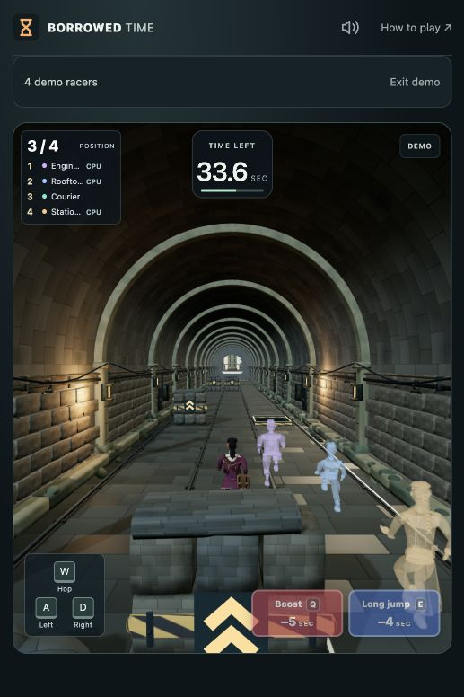

# Browser-only showcase demo

Local checkpoint: `codex/local-showcase-demo`, based on `52e32cf`. Not deployed or submitted. The verified pre-change Git bundle is `backups/pre-local-demo-20261028.bundle`; bundles are ignored by Git.

## Architecture

Watch demo now simulates four computer racers in the viewer's browser. It creates no WebSocket, server room, server simulation or server AI timer. Assets, music and optional aggregate monitoring reports still use HTTP. Real multiplayer retains the authoritative server and interpolation.

`src/demo.js` wraps `src/solo-race.js` with a three-second countdown, fixed 60 Hz simulation and 20 Hz HUD snapshots. The renderer reads the local racers directly each animation frame. `src/main.js` advances the demo only while the document is visible; returning from a hidden tab does not catch up missed time. Exit closes the adapter. Replay creates a fresh course seed and round, preserving demo-only session wins.

The existing AI policy moved unchanged to `src/racer-ai.js`. Solo retains its policy; demo enables the existing pack-aware showcase policy for all four racers, using public rival positions and ordinary purchases. There are no extra speed multipliers, time grants or position corrections. Gameplay, prices, visuals and normal solo behavior are unchanged. The demo hides lobby-code and pause controls.

Maps, characters, rules, collisions, debris scheduling and graphics remain shared. New content added through the normal map/roster definitions feeds the demo too. Presentation and driver policy can change independently. A genuinely new obstacle or ability may need an AI response and test, but no second rules implementation or recording to rebuild. Tests cover the four themed characters on each of the six maps.

## Local measurements

Two roughly 30-second samples used the same Mac and in-app browser on the tunnel map, with a fresh monitored server for each run. No public service was load-tested.

| Measurement | Server-backed demo | Browser-only demo |
|---|---:|---:|
| Race WebSocket connections throughout window | 4 | 0 |
| Server rooms throughout window | 1 | 0 |
| Outbound race JSON during window | 7,928,507 bytes | 0 bytes |
| Outbound race JSON rate | about 264 KB/s | 0 KB/s |
| Mean sampled server CPU, relative to one core | 1.42% | 0.56% |
| Reported browser frame p95 bucket ceiling | 16.8 ms | 16.8 ms |
| Reported frames above 50 ms | 0 / 2,257 | 0 / 3,191 |
| Reported browser / graphics errors | 0 / 0 | 0 / 0 |

Socket, room and race-byte reductions follow directly from removing the transport. CPU is a short local observation, not a capacity guarantee or an isolated AI-cost benchmark. Browser reports cover rolling two-minute windows, arrive in batches, and do not match the exact server interval. Frame p95 is a histogram bucket ceiling, not an exact percentile or phone benchmark. Courses and cache conditions were not identical. HTTP assets/music/diagnostics/dashboard still consume bandwidth and CPU. The browser now does additional simulation work; phone performance and battery use still need testing.

Raw aggregate samples (no monitoring key):

- `artifacts/performance/demo-before-1793193846125.json`
- `artifacts/performance/demo-after-1793194220257.json`

Reproduce with `npm run monitor`, start Watch demo, then run `node scripts/observe-demo.mjs after 30`. The observer reads the ignored local key without printing it and accepts only the fixed localhost endpoint. Use an older checkout/server for a true before comparison. Avoid other online races or release checks during the sample.

## Verification

- Default tests: 176 passed, 14 network-gated skips, zero failures.
- Local network regressions: 45 passed, zero failures, including all-map multiplayer and monitoring access.
- Syntax and whitespace checks passed.
- Local release check passed: 83 assets, metrics access, two same-origin racers, purchases, shared hazards, standings and disconnect cleanup. This does not deploy.
- Browser: complete tunnel race, Watch again, exit, pirate roster/start; no console errors observed.
- New tests cover no transport, countdown, hidden-tab freeze, exit-before-setup, stopped callbacks, snapshot stability, all-map rosters, early abilities, close racing, results and replay. Existing solo and AI-policy tests remain.

