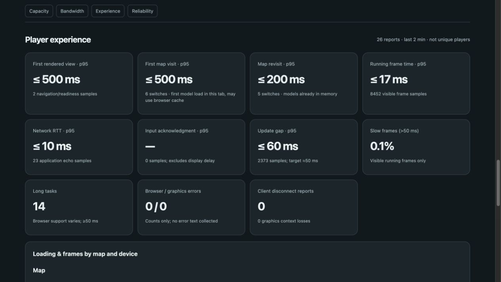

# Selected-map loading and versioned cache — local trial

Branch `codex/map-loading-cache`, based on `a13e283`. No push, deployment or submission. Verified pre-change bundle: `backups/pre-map-loading-cache-20261028.bundle`.

## What changed

- Initial graphics load requests only the selected map's four character GLBs. Other maps load their own rosters when needed. Concurrent requests share a promise per character; successful assets survive a partial failure and retries fetch only missing assets. Legacy study pages can still explicitly preload the whole cast.
- Loading gates drawing and local controls, with completion-based progress and a 45-second recovery deadline. A selection generation prevents a late download from replacing a newer map. Portraits also prepare the selected roster. Solo, demo, online snapshots and menu returns use the same loading coordinator.
- Models, music and map thumbnails use SHA-256 content-version URLs. Only the exact current version gets `public, max-age=31536000, immutable`. Unversioned/stale URLs, HTML, JavaScript, CSS and the version manifest remain `no-store`. Existing gzip negotiation and `Vary: Accept-Encoding` are retained.
- Regenerate versions after changing asset bytes with `npm run build:asset-versions`. `npm run build:avatars` does this automatically. A test checks all 36 hashes against shipped bytes so stale manifests fail validation. The allowlist still protects non-public files.
- No model simplification, audio re-encoding, music/credit changes, gameplay tuning or ability-price changes.

## Measurements and acceptance

The map timer begins at preparation requested by map selection or an incoming online map and ends after the first successful renderer draw. It includes GLB transfer, decoding, scene/character construction and synchronous draw submission. It is not a GPU fence or exact screen-presentation timestamp. Initial page readiness is a separate measurement. Inactive/abandoned selections are discarded; hiding during a pending load invalidates that selection's timing permanently.

`mapFirst` means at least one model was not already decoded in this tab; the HTTP browser cache can still satisfy it. `mapRepeat` means all four models were already in memory. These are not labels proving a cold network or disk-cache hit. Histograms have 50/100/200/500/1000/2000/5000 ms boundaries and a final overflow bucket. Reports are bounded rolling aggregates, not individual users.

One local Mac / in-app-browser trial, loopback server, unthrottled connection:

| Observation | Result |
|---|---:|
| Previous initial character gzip bytes (all 24) | 13,236,334 |
| New initial character gzip bytes (tunnel's four) | 2,226,251 |
| Reduction in initial character transfer | 83.2% |
| Observed initial asset bodies including six thumbnails | 2,235,893 bytes |
| Initial page readiness histogram ceiling | 500 ms |
| First pirate switch | >100 to <=200 ms |
| First jungle/frozen/orbital/desert switches | >200 to <=500 ms each |
| Same-tab revisits: tunnel/pirate/jungle/frozen | >100 to <=200 ms each |
| Same-tab orbital revisit | >50 to <=100 ms |
| Same-tab desert revisit | >200 to <=500 ms |
| Fresh return navigation: additional model/thumbnail response bodies | 0 bytes |

These are single observations/bucket bounds, not statistically reliable p95 estimates. Raw reports: `artifacts/performance/map-cache-initial.json`, `map-cache-pirate-first.json`, `map-cache-all-maps.json`, `map-cache-return-visit.json`. The final report includes the last revisit after its asynchronous telemetry submission arrived. The return-navigation comparison precedes other race/release checks. Download counters exclude HTTP/TLS overhead. Code and pages still download; the zero refers to cached asset bodies only.

The first-load savings are substantial, but not all switches met the proposed <=200 ms target. Even some reused maps take time to rebuild their scene. Keep this as a local trial pending actual phone tests; do not describe desktop loopback results as negligible mobile latency. Slow cellular connections, model decoding and scene construction can dominate on a phone. No browser network throttling, physical-phone measurement or public-host measurement was performed here.

## Device comparison and phone test

The dashboard now groups load/frame measurements by coarse **estimated device** (`mobile`, `desktop`, `unknown`) independently of touch/keyboard controls. Mobile includes tablets detected from browser hints or Android/iPad indicators. Detection can be wrong, particularly under desktop-site settings; no raw user-agent, model name, identity or device fingerprint is sent. Existing bounded schema, report size/rate limits, authentication and expiry apply.

Open `/monitor#experience` to compare first page render, first map preparation and in-memory revisits by map, estimated device and controls. Missing phone reports remain missing, not invented zeros. Real-phone test matrix: first visit to each map, revisits, fresh navigation, Wi-Fi and cellular, then a four-player race. Record phone/browser and test conditions manually alongside aggregate results. The local monitor launcher binds to loopback, so it is not already reachable from a phone; a separately authorized LAN/staging setup will be needed. No external access was enabled.

## Tradeoffs and limits

- Visiting every map still eventually downloads every character. Loaded models remain cached in memory for the tab; there is no eviction policy in this trial. Scene clones/materials are disposed through the existing renderer reset path.
- Browser storage can be evicted or disabled. Normal downloads remain the fallback; this does not provide offline play.
- Music decoding still occurs when needed even if its MP3 bytes are cached. A character cache hit also does not remove model decoding on a fresh page.
- Real multiplayer remains server-authoritative. The server's countdown does not wait for every client's asset readiness; joining/map voting on slow phones needs particular attention in the phone test. The browser suppresses drawing and ability inputs while preparing assets, but the online race clock can advance. If measured phone delays make that significant, add coordinated asset readiness before a production rollout.
- Cache URLs depend on regenerating the manifest for changed assets; keep the freshness test and generation step in the release workflow. No CDN or service worker was added.

## Verification

184 default checks pass (15 network-gated skips); 48 local asset/network/monitoring checks pass. Syntax and whitespace checks pass. Local release check verifies 84 public assets, protected metrics, two-player movement, private purchases, shared hazards, standings and cleanup. Browser checks verified all six first/repeat map loads, zero asset-body bytes on a fresh cached return, and a second tab joining the pirate lobby with only tunnel models initially decoded, then countdown/race/results/exit without console errors. Review fixes cover hidden-tab timing cancellation, keyboard actions during preparation, progress refresh and tablet estimation.

