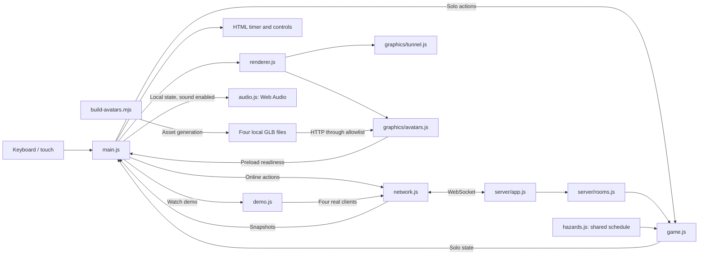
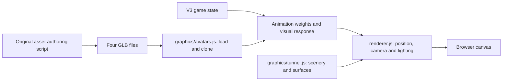
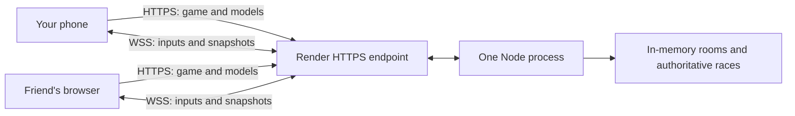

# Borrowed Time: understand the V4 preview end to end

The game asks one question: **does buying an advantage save more time than it costs?** You run forward automatically, choose a lane, and spend countdown seconds on boosts or long jumps. Version **4.0.0-preview.1** adds public deployment and phone layouts to V3.1's visuals and movement presentation. The gameplay remains: solo practice, private multiplayer, an accelerating pace, a simple HUD, four animated characters, timed barrier clearance, and a four-client watch demo.

The railway tunnel grows brighter as you approach its exit. Falling masonry has gameplay rules, while the surrounding collapse is a visual setting rather than a structural physics simulation. [Play the hosted game](https://borrowed-time.onrender.com), or run it locally or on a LAN; the [V4 release record](versions/V4_RELEASE.md) records deployment evidence and remaining phone tests.

V3.1 develops the original procedural art with more deliberate character contours, garment details, material separation and smoother visual transitions. The assets are original code-generated work, not Blender-authored or artist-sculpted models. V4 deploys that game for friend playtesting; physical-device validation remains pending. Consult the [V3.1 design](versions/V3_1_DESIGN.md) and [V3.1 release record](versions/V3_1_RELEASE.md) for scope and actual verification. [V3](versions/V3_RELEASE.md), [V2](versions/V2_RELEASE.md) and [V1](versions/V1_RELEASE.md) remain preserved in Git.

## Start in your editor

In VS Code, choose **File → Open Folder**, select this project, and choose **Terminal → New Terminal**. Codex can edit and run the same files.

```sh
node --version
npm install
npm start
```

Use Node 22 or newer, then open `http://localhost:4173` in a browser with WebGL 2 and graphics acceleration available. Stop the server with **Ctrl+C**. `npm` comes with Node and runs the shortcuts in `package.json`. Installation adds `ws` for networking and Three.js 0.180.0 for graphics.

Save edits and refresh the browser. `npm run dev` restarts watched server code but does not refresh the browser. `PORT=4174 npm start` selects a different port. See the [README](../README.md) for two-player and LAN setup.

## What each technology contributes

A framework supplies a predefined application structure. This project uses platform features directly, making the whole program small enough to trace.

| Technology | Responsibility | Why it fits |
| --- | --- | --- |
| HTML + CSS | Controls, status panels, layout, styling | Standard browser UI around the scene. |
| JavaScript ES modules | Imports, rules, inputs, coordination | Explicit file boundaries, no compilation step. |
| Three.js + WebGL 2 | 3D tunnel, camera, lighting, articulated avatars, obstacles and ghosts | Uses the browser's graphics API to draw real geometry while keeping the rest of the application in plain JavaScript. |
| Node.js | File serving, multiplayer simulation, tests | Runs JavaScript outside the browser and reuses the rules. |
| `ws` | Server-side WebSocket connections | A networking package for Node; browsers already have a WebSocket API. |

Three.js is a rendering library. A **mesh** combines 3D geometry, such as the vertices of a coat or arch, with a material describing its surface. A perspective camera views those meshes, lights shade them, and WebGL 2 draws them on the canvas using the graphics hardware. The earlier Canvas 2D renderer simulated depth by scaling flat shapes; V3 uses actual three-dimensional geometry and a depth buffer that determines which surfaces cover others. Small offscreen 2D canvases still generate textures such as brick patterns and signs.

No bundler or frontend build is required. An **import map** in `index.html` tells the browser that `import * as THREE from 'three'` means the locally served Three.js module. The Node server exposes an explicit list of required Three.js modules, loader helpers, public game files, and four GLB assets; it does not publish the entire dependency directory. Game rules remain independent of the graphics library.

**HTTP** delivers the page and its files in request/response exchanges. **WebSocket** keeps a connection open so input and state updates can travel both ways during a race. Both use the same Node server; the WebSocket endpoint is `/race`.

The frontend is what runs in each browser. The backend is the shared Node process. Solo rules run locally in the browser; multiplayer rules run on the backend. Merely editing your browser's timer cannot give your server-owned racer more time.

## A useful code-reading order

| File | What to look for |
| --- | --- |
| `src/game.js` | State, tuning constants, ability purchases, movement, collisions, finishing. |
| `src/main.js` | Asset readiness, keyboard/touch handling, solo/online/demo flow, minimal HUD and results. |
| `src/hazards.js` | Seeded falling-event schedules and visual phases from elapsed race time. |
| `src/avatars.js` | Four cosmetic character IDs and display metadata. |
| `src/renderer.js` | Three.js scene, camera, lighting, hazard presentation and ghost placement. |
| `src/graphics/tunnel.js` | Procedural tunnel geometry, texture generation, exit and skyline. |
| `src/graphics/avatars.js` | GLB preloading, independent avatar clones, animation mixing, and cleanup. |
| `scripts/build-avatars.mjs`, `assets/characters/` | Reproducible original character source, exported GLBs, and provenance notes. |
| `docs/character-preview.html` | Developer art study using the real character assets; no gameplay selection. |
| `src/network.js` | WebSocket messages, connection state, interpolation between snapshots. |
| `src/demo.js` | Four real demo clients, ordinary bot inputs, automatic starts/rematches, and cleanup. |
| `src/audio.js` | Optional local footsteps and event sounds, generated through Web Audio after a user gesture. |
| `src/server/rooms.js` | Membership, host, countdown, authoritative races, results. |
| `src/server/app.js` | HTTP serving, WebSocket connections, simulation and broadcast scheduling. |
| `server.js` | Starts the service using `HOST` and `PORT`. |
| `index.html`, `styles.css` | Page structure, controls, styling. |
| `tests/game.test.js`, `tests/v3-rules.test.js`, `tests/hazards.test.js` | Rules, exact acceleration, jump clearance, timed debris, and repeatable schedules. |
| `tests/avatars-assets.test.js`, `tests/demo.test.js` | Exported assets, loading/disposal, demo room lifecycle, and bot playthroughs. |
| `tests/server.test.js`, `tests/network.test.js`, `tests/assets.test.js` | Rooms, sockets, assignments, browser interpolation and allowed public files. |

The HUD, or heads-up display, presents remaining time, ability prices and availability, movement controls, and hazard feedback. Gameplay and results omit distance, sectors, hit counts, spending totals, and elapsed-run statistics. Those values still exist internally for rules and debugging. The HUD displays state; it does not decide what a purchase costs.



## Follow one purchase through the system

In solo, pressing **1** reaches `main.js`, which asks `buyAbility` in `game.js` to buy a boost. In multiplayer, the browser instead sends an intention such as:

```js
{ type: 'input', action: 'boost', seq: 7, roundId: '…' }
```

The server identifies the player from the connection, validates the round and sequence number, and calls the same rules. On an accepted purchase:

```js
game.timeLeft -= ability.cost;
game.timeSpent += ability.cost;
```

It activates the boost and cooldown, then sends an updated snapshot. The browser updates your HUD and draws the world.

```text
Your button → browser input → WebSocket → server validation
             → game rules → updated state → snapshot
             → browser HUD and Three.js drawing
```

This is **server authority**: clients request actions; the server decides their effects. Clients do not submit trusted balances, positions, winners, or another player's identity. Old round IDs and repeated sequence numbers are rejected. Authority is a useful foundation, not a claim that all possible cheating is solved.

A **snapshot** is a message describing current state. Your own snapshot includes your race details. Opponent data contains identity, assigned avatar, player color, connection/phase information, and motion needed for rendering—not their timers, spending, boost flags, or jump type. Their visible motion can still reveal that they are moving faster or jumping. Shared room data includes the round seed and elapsed race clock, allowing each browser to reconstruct the same obstacle and falling-event schedule.

## State, time, and collisions

A run's state is a plain object: phase, lane, distance, remaining time, effects, obstacles, falling events, avatar identity, and statistics. Game phases are `ready`, `running`, `paused`, `won`, and `lost`. Multiplayer room phases separately track `lobby`, `countdown`, `racing`, and `finished`.

The simulation advances in fixed 1/60-second steps. Solo uses a browser accumulator; multiplayer uses the server's loop. The browser draws at its display's animation rate. Inside `updateGame`, a step splits at collisions, time gates, effect expirations, the acceleration cap, timed impacts, timer expiry, and the exit. Within each piece, speed changes linearly and boost/stun multipliers stay constant. The rules integrate that motion exactly and solve for crossing times, so a large update and many small updates produce the same outcome within floating-point precision.

```js
game.elapsed += step;
game.distance += game.speed * step + acceleration * step * step / 2;
game.timeLeft = Math.max(0, game.timeLeft - step);
```

These lines advance elapsed time, add the distance traveled during constant acceleration, and keep the countdown nonnegative. Base speed rises from 22 to 32m/s over the first 50 elapsed running seconds, then stays at 32m/s. Before the cap, an unobstructed unboosted runner travels `22t + 0.1t²` meters; at 50 seconds that is exactly 1,350m. Pause freezes this progress. Purchases change the spendable balance, not the acceleration clock.

Keep two different clocks in mind. **Elapsed race time** only advances while the simulation runs and schedules the falling masonry. **Remaining time** is your spendable balance: purchases and hits subtract from it, while checkpoints add to it. Buying a boost does not fast-forward a falling event. Online, the server advances a shared room race clock, and browser interpolation carries that clock into the hazard visuals. A runner finishing does not stop the room's clock while others are still racing.

| Rule | Current value |
| --- | --- |
| Start / finish | 60 seconds; internal exit distance 1,350m; base speed 22→32m/s over 50 elapsed running seconds. |
| Free hop | 0.65 seconds; 1.15m peak height; clears small rubble. |
| Boost | Costs 3 seconds; 1.85× speed for 4 seconds; 7-second cooldown from activation. |
| Long jump | Costs 2 seconds; lasts 1.4 seconds; 3m peak height; clears rubble, gaps, and correctly timed tall barriers. |
| Collision | Costs 3 seconds; speed becomes 45% for 0.8 seconds. |
| Time gates | +5 seconds at internal distances of 450m and 900m; displayed as time pickups. |
| Ordinary encounters | First at 90m internally, then spaced 72–89m apart; at least one lane remains open. |
| Falling masonry | Warning begins 2.4 seconds before impact; the final 0.45 seconds are the visible descent. |

These distances and heights are developer tuning measurements, not gameplay HUD readouts. Purchases require strictly more time than their price. A long jump can upgrade a normal hop but cannot extend an active long jump. The internal `timeSpent` field records purchases, not countdown or collision losses.

An ordinary obstacle resolves once when you reach its distance. Its lane and your jump determine the outcome. A tall barrier can be avoided by changing lanes or by reaching at least 2.2m of visible clearance during a paid jump. The shared `getJumpHeight(state)` function uses public jump duration and remaining time for local motion, opponent motion, and barrier collisions. A paid sine arc clears that threshold approximately 0.37–1.03 seconds after takeoff; a free hop never reaches it. An early or late paid jump can still hit the barrier.

A gap checks for a long jump at its front edge; the rules do not simulate continuous flight across its full length. Missing a gap applies the normal penalty. Reach the exit to win your run; running out of time first loses. Reaching the exit exactly as time expires counts as escaping.

Solo restart uses seed 42. A seed makes generated randomness repeatable. Multiplayer gives everyone the same round seed, then chooses a new seed for a rematch. Every encounter leaves at least one lane clear.

## Follow a falling chunk

`createFallingDebris` places sparse single-lane events between ordinary encounters. Impact times match the nominal arrival of an unboosted runner following the acceleration curve. Each event records its lane, course distance, and warning, fall, and impact times. `getDebrisPhase(event, elapsed)` returns `waiting`, `warning`, `falling`, or `landed`.

1. Before the warning time, the event stays hidden.
2. An amber ground marker identifies the landing lane before the chunk falls.
3. The chunk descends for 0.45 seconds, then the simulation checks its landing footprint at the scheduled impact time. Move out of its lane to avoid that impact; neither a free hop nor a paid jump protects you beneath it.
4. The landed chunk leaves rubble. A player who reaches it later can hop over it.

The normal hit penalty and slowdown apply to both impact and rubble. Per-player resolution data prevents the same chunk from charging the same runner twice. `updateGame` splits steps at impact times and course crossings so a larger update cannot simply skip them. The renderer animates those phases; it does not decide hits. Solo pause freezes the hazard clock, while an online room keeps running when a player switches tabs.

## Rooms and visible opponents

A guest creates a room and shares its six-character code. The browser assigns a guest name, and entering a custom name is optional. Up to four people join; the host needs at least two to start. A shared three-second countdown precedes the race. Mid-round joins are rejected. Players finish individually, and the room finishes after all runs end; the earliest successful finish determines the winner. If everyone fails, there is no winner.

The server randomly chooses among unused character IDs, so a four-player room has one Courier, Engineer, Station Guard, and Rooftop Runner, each with a distinct player color. The Courier has a lean build, curly ponytail, burgundy jacket, and satchel. The Engineer is broader, with copper hair, work overalls, and goggles. The Station Guard is a tall, angular older woman with a silver braid and navy uniform. The Rooftop Runner is a shorter, compact young adult with cropped hair and a short green jacket. All four use identical gameplay rules. There is no character-selection step, and client messages cannot choose the assigned avatar. Rematches retain avatar and color while resetting the course and falling events. Solo restarts also retain the current avatar.

The host can then prepare a rematch. Leaving transfers host ownership to another connected player. A disconnected racer is marked out, removed from drawing, and cannot resume that run. Other racers continue. Switching away from the tab pauses solo practice only.

The server simulates at 60 steps per second and broadcasts at 20 updates per second. **Interpolation** blends neighboring snapshots to smooth motion between messages. That adds a small display delay; it does not grant the client authority.

Opponent ghosts are actual connected racers at relative positions. They have no collision, statistics overlay, or ability effects. A racer who falls behind your camera disappears naturally. There is no rubber-banding to keep them visible.

The 3D renderer keeps the local runner near the camera and positions the world and other players relative to that runner's distance. A single scale compresses displayed course depth consistently for scenery, hazards, and all racers; simulation distances stay in meters. Daylight follows course progress, not the spendable countdown.

Each avatar uses a skinned mesh and a 24-bone skeleton: rotating a shoulder moves its forearm and hand, and rotating a hip moves its knee and boot. The renderer owns world position and the shared jump arc; the avatar module animates internal joints. Merged geometry and repeated environment instances reduce drawing work, rendering resolution is capped, and expensive shadows are limited. These choices control cost but do not establish a measured mobile performance guarantee. Reduced-motion settings tone down secondary movement. If WebGL 2 is unavailable or the graphics context is lost, the app displays a recovery message instead of continuing an unseen race.

## Build and load the character assets

The original source is `scripts/build-avatars.mjs`. It generates contoured geometry, vertex colors, materials, skin weights, and four animation clips named `idle`, `run`, `jump`, and `stumble`. Node and Three.js's GLTF exporter package each character into a real binary GLB file:

```sh
npm run build:avatars
```

The outputs live in `assets/characters/`, alongside a generated manifest and [provenance notes](../assets/characters/README.md). The checked-in GLBs let a fresh checkout run without regenerating art. This asset-generation command is separate from starting the game; there is still no frontend build step. The files can later be imported into a modeling tool, but this version was generated in Node and was not authored in Blender.

At startup, `preloadAvatars()` asynchronously loads all four files before the app enables play. Each visible runner gets an independent skeleton, animation mixer, and cloned materials. Geometry stays in a shared source cache, so disposing one runner cannot break another. A failed preload clears the pending load promise so a later attempt is possible; the current app exposes recovery through a visible message and **Reload game** button.

Open the [character study](http://localhost:4173/docs/character-preview.html) with the local server running to inspect the actual four assets and their motion. This page is a developer reference, not a character selector. The game still assigns characters automatically.

V3 also adds varied masonry surfaces and damaged architecture, warmer lamps and daylight, dust, visible impact feedback, and restrained boost/camera effects. These are procedural visual techniques. The tunnel collapse is not structural simulation, secondary hair and coat movement is not cloth physics, and the authored gait is not runtime terrain adaptation. Art refinement and physical-device/performance validation remain separate work.

## Follow the four-client watch demo

The **Watch four-player demo** button calls `createDemoRace` in `src/demo.js`. It opens a normal host connection and three guest connections through `connectRace`, named Demo · Ash, Demo · Briar, Demo · Cleo, and Demo · Drew. Once all four join, the host starts the normal three-second countdown. The app labels these participants as simulated runners and disables manual gameplay controls while watching.

Every 150ms, each bot considers its own private snapshot and the course reconstructed from the shared seed, then sends a normal lane change, hop, paid jump, or boost. It cannot set positions, add time, or read another player's private balance. Slightly staggered planned boosts and different lane choices give the group visible variation; positions still come entirely from server rules. The opening boost waits until after the first timed fall so that hazard is visible near the runners.

Only the host client's snapshots feed the displayed view. Its opponent list has the same public fields used in human races, and the renderer draws those actual server positions. The other three private snapshots stay inside their respective demo policies.

A rematch uses the normal host request and starts automatically when the next four-player lobby appears. Exiting closes all four connections and clears the decision timer. A fatal connection failure also closes the group and reports a disconnection; callbacks arriving after closure are ignored. The demo demonstrates the networking flow, while its automated participants do not establish four-human usability, internet latency, or device-performance claims.

## Ask the system-design questions first

These are the kinds of scope and scale questions used in an Alex Xu-style system-design discussion; the answers below describe this project, not a forecast.

| Question | V4 preview answer |
| --- | --- |
| Who uses it, and how many use it now? | Known use is development/playtesting. Production users and measured demand are unknown. |
| What must work? | Solo practice, private 2–4-player rooms, four unique characters, shared course/start and falling schedule, fair purchases, readable opponents, simple results/rematches, and a labeled four-client demo. |
| What matters besides features? | Consistent authoritative rules, responsive motion, private opponent statistics, bounded resource use. |
| What can wait? | Accounts, matchmaking, reconnects, saved leaderboards, chat, and multiple server processes. |
| Where does data live? | In one process's memory. Restarting Node loses rooms and results. |

| Horizon | Illustrative monthly players | Illustrative peak connected players |
| --- | ---: | ---: |
| 3 months | 100 | 20 |
| 6 months | 1,000 | 100 |
| 12 months | 10,000 | 500 |

These are planning scenarios, not predictions or tested capacity. The server permits at most 25 rooms and 128 connections; raising a limit is not proof of capacity. Empty rooms disappear immediately; idle lobbies and finished rooms expire after five minutes. Measure latency, CPU, memory, event-loop delay, network traffic, and browser frame time before changing architecture. At larger measured demand, keep each room on one server and route clients to that server. Add a database when saved results become a feature. Public hosting also needs a WebSocket-capable service and HTTPS/WSS; a local URL is not a submission URL.

## Learn through small changes

1. **Understand:** change a boost price in `ABILITIES`, predict its effect, and compare solo runs on the same seed.
2. **Improve:** change a character material/profile in `scripts/build-avatars.mjs`, run `npm run build:avatars`, and refresh; or change a light in `src/renderer.js`. Observe why presentation changes do not alter gameplay. For rule changes such as `CONFIG.encounterSpacing`, update relevant tests; this also affects the spaces available for falling events. Three lanes are assumed in several places; `laneCount` alone cannot redesign the course.
3. **Operate:** run the public deployment check, measure latency during friend races, and document the host and device limits you observe.

Use `npm test` for rules, rooms, avatar assets, and demo behavior; `npm run test:network` for real HTTP/WebSocket integration; and `npm run check` for syntax. Socket tests are skipped in the ordinary test command. Browser playtesting still matters for controls and visual clarity. Keep documentation and initial HTML fallback text aligned with configuration changes.

Explain these before presenting the project: Why separate rules from drawing? Why fixed steps? Why do falling events use a different clock from the spendable timer? What does a sequence number prevent? Why is your opponent's private timer absent? What disappears after a server restart? How would you measure whether one server and a target device are fast enough?

Résumé draft, once verified and understood:

> Built and deployed an AI-assisted JavaScript/Three.js multiplayer game with server-authoritative WebSocket rooms, timer-based ability purchases, synchronized falling hazards, and automated rule/network tests.

Adjust the wording to your own contribution and demonstrated verification. Public deployment is recorded in V4; user counts and production scale are not established.

## Optional audio

`main.js` creates `createGameAudio()` once and passes it the local rendered state each frame. `audio.js` compares that state with the previous frame: a new jump, boost, hit, landing, or finish triggers a short sound. Distance between footfalls controls the running rhythm, so faster running sounds faster too. These are presentation cues; sound never changes game rules or sends multiplayer messages.

The sound button is the only place that creates or resumes an `AudioContext`, because browsers require a user gesture for playback. Sound starts muted. Resetting a run or returning from a hidden tab establishes a silent baseline so old events do not replay. Each sound node stops and disconnects, with a maximum of 24 simultaneous voices.

## V3.1: improve presentation without changing the rules

A character model is the shape; its materials describe how the surfaces respond to light. A skeleton gives that shape joints. An animation clip describes a sequence of joint poses. V3.1 refines these ingredients while keeping V3's game-state calculations intact.



The direction is one way: presentation reads game state. A lean, coat movement or camera effect does not spend time, move a collision boundary or decide a race result. The renderer still uses `getJumpHeight()` from the shared rules for the character's height above obstacles.

Smoothing has to use time, not the number of frames. A screen drawing 120 frames per second should approach a target pose at the same rate as a screen drawing 30. Short transitions make a boost feel like the runner leans into it; a landing can compress the body briefly before returning to the run pose. Pausing freezes these effects and replay resets them.

In `renderer.js`, `createPresentationMotion()` keeps the visual lane, camera follow, boost response and up to three opponent tracks. Its `update()` reads the latest state and the time since the previous frame; `reset()` clears that visual history. In `graphics/avatars.js`, each avatar samples the exported clips, blends reactions and exposes its own `reset()` to restore the skeleton. The renderer calls both reset paths when starting another run so the previous race's lean or pose cannot carry over.

The developer character study now offers quarter-speed playback, a boost toggle and **Freeze pose**, plus front/back/side views. Use it to inspect a sleeve, a foot contact or a transition; then check the same character at the actual running camera distance. The study compresses jump height to fit the models in view, so it is not a collision test. The game remains the place to verify obstacle clearance.

Public hosting and tests on physical phones belong to V4. V3.1's browser checks and limitations are recorded in the release notes; browser resizing alone is not proof of mobile hardware performance.

## V4: put the same game on the internet

The game still has the same frontend and backend. Deployment moves the Node process from your computer to a hosted server, where your phone and friends can reach it at [borrowed-time.onrender.com](https://borrowed-time.onrender.com). Render provides the HTTPS endpoint; the browser automatically uses secure `wss:` for `/race` on that address. Your computer no longer needs to stay running for friends to play.



`Dockerfile` is the packaging recipe: install the exact locked dependencies, copy the runtime files, then run `node server.js`. `.dockerignore` keeps unnecessary files out of the build context. `render.yaml` describes the host configuration, including one free instance and the `/health` check. The health route tells the host that the process is responding; it does not prove that a complete race works.

That is why `scripts/check-deployment.mjs` goes further. It checks the public game assets, connects two real WebSocket clients, creates and joins a room, starts a race, purchases one player's boost, and checks movement and cleanup. Run it with `npm run check:deployment -- https://borrowed-time.onrender.com` after deploying a change.

The source lives in the private `wadavis95-cloud/borrowed-time` GitHub repository. Render watches its `main` branch and builds the Docker image when a change is pushed there. Saving a local file alone does not update the public game. Make and test the change, commit it, push it to the deployment branch, then verify that Render reports the new revision live. Avoid deploying during a friend race because replacing the process clears its rooms.

One process matters because each room is stored in that process's memory. Starting a second instance without shared room routing could send two friends to different room lists. Deploying or restarting clears the existing rooms. The free service may sleep while idle and need about a minute to wake; open it before gathering friends.

The phone layout changes use CSS screen size and pointer capabilities. Short landscape screens put abilities beside the course; portrait screens reserve space below it. Safe-area padding avoids notches and home indicators. These changes do not lower graphics quality or change collision rules. Actual phone GPU speed, touch feel and battery behavior still need a physical device test using the [V4 playtest steps](versions/V4_RELEASE.md).
