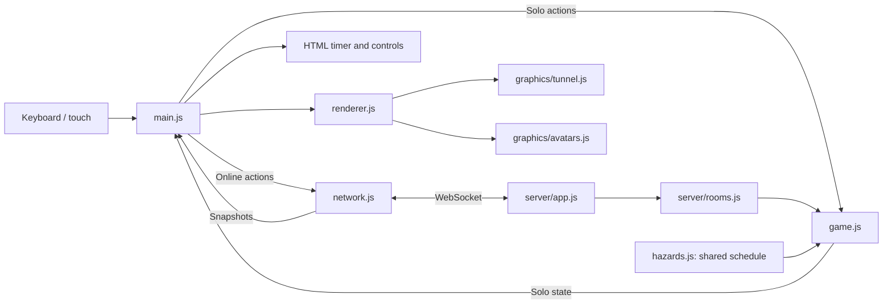

# Borrowed Time: understand the V2 preview end to end

The game asks one question: **does buying an advantage save more time than it costs?** You run forward automatically, choose a lane, and spend countdown seconds on boosts or long jumps. Version **2.0.0-preview.1** keeps solo practice and private multiplayer, and adds a real 3D tunnel, two animated avatars, and timed falling masonry.

The railway tunnel grows brighter as you approach its exit. Falling masonry has gameplay rules, while the surrounding collapse is a visual setting rather than a structural physics simulation. The implementation runs locally or on a LAN; it has not been publicly deployed.

This is the first playable procedural art pass. The models, clothing, and environment are generated by code; the approved concept images guide their design without promising the same finished detail. Physical mobile devices and broad graphics performance have not been validated. Consult the [V2 design](versions/V2_DESIGN.md) and [V2 release record](versions/V2_RELEASE.md) for scope and actual verification. The [V1 release record](versions/V1_RELEASE.md) and tag `v1.0.0` preserve the earlier version.

## Start in your editor

In VS Code, choose **File → Open Folder**, select this project, and choose **Terminal → New Terminal**. Codex can edit and run the same files.

```sh
node --version
npm install
npm start
```

Use Node 22 or newer, then open `http://localhost:4173` in a browser with WebGL 2 and graphics acceleration available. Stop the server with **Ctrl+C**. `npm` comes with Node and runs the shortcuts in `package.json`. Installation adds `ws` for networking and Three.js 0.180.0 for graphics.

Save edits and refresh the browser. `npm run dev` restarts watched server code but does not refresh the browser. `PORT=4174 npm start` selects a different port. See the [README](../README.md) for two-player and LAN setup.

## What each technology contributes

A framework supplies a predefined application structure. This project uses platform features directly, making the whole program small enough to trace.

| Technology | Responsibility | Why it fits |
| --- | --- | --- |
| HTML + CSS | Controls, status panels, layout, styling | Standard browser UI around the scene. |
| JavaScript ES modules | Imports, rules, inputs, coordination | Explicit file boundaries, no compilation step. |
| Three.js + WebGL 2 | 3D tunnel, camera, lighting, articulated avatars, obstacles and ghosts | Uses the browser's graphics API to draw real geometry while keeping the rest of the application in plain JavaScript. |
| Node.js | File serving, multiplayer simulation, tests | Runs JavaScript outside the browser and reuses the rules. |
| `ws` | Server-side WebSocket connections | A networking package for Node; browsers already have a WebSocket API. |

Three.js is a rendering library. A **mesh** combines 3D geometry, such as the vertices of a coat or arch, with a material describing its surface. A perspective camera views those meshes, lights shade them, and WebGL 2 draws them on the canvas using the graphics hardware. The earlier Canvas 2D renderer simulated depth by scaling flat shapes; V2 uses actual three-dimensional geometry and a depth buffer that determines which surfaces cover others. Small offscreen 2D canvases still generate textures such as brick patterns and signs.

No bundler or frontend build is required. An **import map** in `index.html` tells the browser that `import * as THREE from 'three'` means the locally served Three.js module. The Node server exposes only the two needed vendor files and the game's public files; it does not publish the entire dependency directory. Game rules remain independent of the graphics library.

**HTTP** delivers the page and its files in request/response exchanges. **WebSocket** keeps a connection open so input and state updates can travel both ways during a race. Both use the same Node server; the WebSocket endpoint is `/race`.

The frontend is what runs in each browser. The backend is the shared Node process. Solo rules run locally in the browser; multiplayer rules run on the backend. Merely editing your browser's timer cannot give your server-owned racer more time.

## A useful code-reading order

| File | What to look for |
| --- | --- |
| `src/game.js` | State, tuning constants, ability purchases, movement, collisions, finishing. |
| `src/main.js` | Keyboard/touch handling, solo versus multiplayer flow, HUD updates. |
| `src/hazards.js` | Seeded falling-event schedules and visual phases from elapsed race time. |
| `src/avatars.js` | The two cosmetic avatar identities and display metadata. |
| `src/renderer.js` | Three.js scene, camera, lighting, hazard presentation and ghost placement. |
| `src/graphics/tunnel.js` | Procedural tunnel geometry, texture generation, exit and skyline. |
| `src/graphics/avatars.js` | Courier and Engineer geometry, articulated rigs and cosmetic animation. |
| `src/network.js` | WebSocket messages, connection state, interpolation between snapshots. |
| `src/server/rooms.js` | Membership, host, countdown, authoritative races, results. |
| `src/server/app.js` | HTTP serving, WebSocket connections, simulation and broadcast scheduling. |
| `server.js` | Starts the service using `HOST` and `PORT`. |
| `index.html`, `styles.css` | Page structure, controls, styling. |
| `tests/game.test.js`, `tests/hazards.test.js` | Executable examples of game rules, timed debris and repeatable schedules. |
| `tests/server.test.js`, `tests/network.test.js`, `tests/assets.test.js` | Rooms, sockets, assignments, browser interpolation and allowed public files. |

The HUD, or heads-up display, is your timer, distance, and ability status. It displays state; it does not decide what a purchase costs.



## Follow one purchase through the system

In solo, pressing **1** reaches `main.js`, which asks `buyAbility` in `game.js` to buy a boost. In multiplayer, the browser instead sends an intention such as:

```js
{ type: 'input', action: 'boost', seq: 7, roundId: '…' }
```

The server identifies the player from the connection, validates the round and sequence number, and calls the same rules. On an accepted purchase:

```js
game.timeLeft -= ability.cost;
game.timeSpent += ability.cost;
```

It activates the boost and cooldown, then sends an updated snapshot. The browser updates your HUD and draws the world.

```text
Your button → browser input → WebSocket → server validation
             → game rules → updated state → snapshot
             → browser HUD and Three.js drawing
```

This is **server authority**: clients request actions; the server decides their effects. Clients do not submit trusted balances, positions, winners, or another player's identity. Old round IDs and repeated sequence numbers are rejected. Authority is a useful foundation, not a claim that all possible cheating is solved.

A **snapshot** is a message describing current state. Your own snapshot includes your race details. Opponent data contains identity, assigned avatar, player color, connection/phase information, and motion needed for rendering—not their timers, spending, boost flags, or jump type. Their visible motion can still reveal that they are moving faster or jumping. Shared room data includes the round seed and elapsed race clock, allowing each browser to reconstruct the same obstacle and falling-event schedule.

## State, time, and collisions

A run's state is a plain object: phase, lane, distance, remaining time, effects, obstacles, falling events, avatar identity, and statistics. Game phases are `ready`, `running`, `paused`, `won`, and `lost`. Multiplayer room phases separately track `lobby`, `countdown`, `racing`, and `finished`.

The simulation advances in fixed 1/60-second steps. Solo uses a browser accumulator; multiplayer uses the server's loop. The browser draws at its display's animation rate. Inside `updateGame`, steps split at important events so a collision or expired effect is handled at its crossing time.

```js
game.elapsed += step;
game.distance += game.speed * step;
game.timeLeft = Math.max(0, game.timeLeft - step);
```

These lines mean elapsed time rises, distance equals speed multiplied by time, and the countdown never becomes negative.

Keep two different clocks in mind. **Elapsed race time** only advances while the simulation runs and schedules the falling masonry. **Remaining time** is your spendable balance: purchases and hits subtract from it, while checkpoints add to it. Buying a boost does not fast-forward a falling event. Online, the server advances a shared room race clock, and browser interpolation carries that clock into the hazard visuals. A runner finishing does not stop the room's clock while others are still racing.

| Rule | Current value |
| --- | --- |
| Start / finish | 60 seconds; exit at 900 meters; base speed 18 meters/second. |
| Free hop | 0.65 seconds; clears rubble. |
| Boost | Costs 3 seconds; 1.85× speed for 4 seconds; 7-second cooldown from activation. |
| Long jump | Costs 2 seconds; lasts 1.4 seconds; clears rubble and gaps. |
| Collision | Costs 3 seconds; speed becomes 45% for 0.8 seconds. |
| Checkpoints | +5 seconds at 300 and 600 meters. |

Purchases require strictly more time than their price. A long jump can upgrade a normal hop but cannot extend an active long jump. `timeSpent` records purchases, not countdown or collision losses.

An ordinary obstacle resolves once when you reach its distance. Its lane and your jump determine the outcome. Tall barriers require a lane change. A gap checks for a long jump at its front edge; the rules do not simulate continuous flight across its full length. Missing a gap applies the normal penalty. Reach the exit to win your run; running out of time first loses. Reaching the exit exactly as time expires counts as escaping.

Solo restart uses seed 42. A seed makes generated randomness repeatable. Multiplayer gives everyone the same round seed, then chooses a new seed for a rematch. Every encounter leaves at least one lane clear.

## Follow a falling chunk

`createFallingDebris` places sparse single-lane events between ordinary encounters. Each event records its lane, course distance, and warning, fall, and impact times. `getDebrisPhase(event, elapsed)` returns `waiting`, `warning`, `falling`, or `landed`.

1. Before the warning time, the event stays hidden.
2. An amber ground marker identifies the landing lane before the chunk falls.
3. The chunk descends, then the simulation checks its landing footprint at the scheduled impact time. Move out of its lane to avoid that impact; being airborne does not protect you beneath it.
4. The landed chunk leaves rubble. A player who reaches it later can hop over it.

The normal hit penalty and slowdown apply to both impact and rubble. Per-player resolution data prevents the same chunk from charging the same runner twice. `updateGame` splits steps at impact times and course crossings so a larger update cannot simply skip them. The renderer animates those phases; it does not decide hits. Solo pause freezes the hazard clock, while an online room keeps running when a player switches tabs.

## Rooms and visible opponents

A guest creates a room and shares its six-character code. The browser assigns a guest name, and entering a custom name is optional. Up to four people join; the host needs at least two to start. A shared three-second countdown precedes the race. Mid-round joins are rejected. Players finish individually, and the room finishes after all runs end; the earliest successful finish determines the winner. If everyone fails, there is no winner.

The server automatically assigns Courier or Engineer, balancing the two identities across room members. With four players, avatars repeat; each player receives a distinct color. The Courier has a lean build, curly ponytail, burgundy-and-ivory jacket, and satchel. The Engineer has a broader build, copper hair, gold shirt, charcoal overalls, and goggles. Both use identical gameplay rules. There is no character-selection step, and client messages cannot choose the assigned avatar. Rematches retain avatar and color while resetting the course and falling events. Solo restarts also retain the current avatar.

The host can then prepare a rematch. Leaving transfers host ownership to another connected player. A disconnected racer is marked out, removed from drawing, and cannot resume that run. Other racers continue. Switching away from the tab pauses solo practice only.

The server simulates at 60 steps per second and broadcasts at 20 updates per second. **Interpolation** blends neighboring snapshots to smooth motion between messages. That adds a small display delay; it does not grant the client authority.

Opponent ghosts are actual connected racers at relative positions. They have no collision, statistics overlay, or ability effects. A racer who falls behind your camera disappears naturally. There is no rubber-banding to keep them visible.

The 3D renderer keeps the local runner near the camera and positions the world and other players relative to that runner's distance. A single scale compresses displayed course depth consistently for scenery, hazards, and all racers; simulation distances stay in meters. Daylight follows course progress, not the spendable countdown.

The avatar rig is a hierarchy of groups: rotating a shoulder moves its forearm and hand, and rotating a hip moves its knee and boot. The renderer owns the runner's world position and jump height; the avatar module moves the internal joints. Merged geometry and repeated environment instances reduce drawing work, rendering resolution is capped, and expensive shadows are limited. These choices control cost but do not establish a measured mobile performance guarantee. Reduced-motion settings tone down secondary movement. If WebGL 2 is unavailable or the graphics context is lost, the app displays a recovery message instead of continuing an unseen race.

## Ask the system-design questions first

These are the kinds of scope and scale questions used in an Alex Xu-style system-design discussion; the answers below describe this project, not a forecast.

| Question | V2 preview answer |
| --- | --- |
| Who uses it, and how many use it now? | Known use is development/playtesting. Production users and measured demand are unknown. |
| What must work? | Solo practice, private 2–4-player rooms, a shared course/start and falling schedule, fair purchases, readable 3D opponents, results, and leaving. |
| What matters besides features? | Consistent authoritative rules, responsive motion, private opponent statistics, bounded resource use. |
| What can wait? | Accounts, matchmaking, reconnects, saved leaderboards, chat, and multiple server processes. |
| Where does data live? | In one process's memory. Restarting Node loses rooms and results. |

| Horizon | Illustrative monthly players | Illustrative peak connected players |
| --- | ---: | ---: |
| 3 months | 100 | 20 |
| 6 months | 1,000 | 100 |
| 12 months | 10,000 | 500 |

These are planning scenarios, not predictions or tested capacity. The server permits at most 25 rooms and 128 connections; raising a limit is not proof of capacity. Empty rooms disappear immediately; idle lobbies and finished rooms expire after five minutes. Measure latency, CPU, memory, event-loop delay, network traffic, and browser frame time before changing architecture. At larger measured demand, keep each room on one server and route clients to that server. Add a database when saved results become a feature. Public hosting also needs a WebSocket-capable service and HTTPS/WSS; a local URL is not a submission URL.

## Learn through small changes

1. **Understand:** change a boost price in `ABILITIES`, predict its effect, and compare solo runs on the same seed.
2. **Improve:** change a material in `src/graphics/avatars.js` or a light in `src/renderer.js`, then observe why presentation changes do not alter gameplay. For rule changes such as `CONFIG.encounterSpacing`, update relevant tests; this also affects the spaces available for falling events. Three lanes are assumed in several places; `laneCount` alone cannot redesign the course.
3. **Operate:** verify two real clients, measure latency, then deploy on a chosen host and document the actual limits.

Use `npm test` for rules and rooms, `npm run test:network` for real HTTP/WebSocket integration, and `npm run check` for syntax. Socket tests are skipped in the ordinary test command. Browser playtesting still matters for controls and visual clarity. Keep documentation and initial HTML fallback text aligned with configuration changes.

Explain these before presenting the project: Why separate rules from drawing? Why fixed steps? Why do falling events use a different clock from the spendable timer? What does a sequence number prevent? Why is your opponent's private timer absent? What disappears after a server restart? How would you measure whether one server and a target device are fast enough?

Résumé draft, once verified and understood:

> Built an AI-assisted JavaScript/Three.js multiplayer game with server-authoritative WebSocket rooms, timer-based ability purchases, synchronized falling hazards, and automated rule/network tests.

Adjust the wording to your own contribution and demonstrated verification. Only claim public deployment, user counts, or production scale once those exist.
