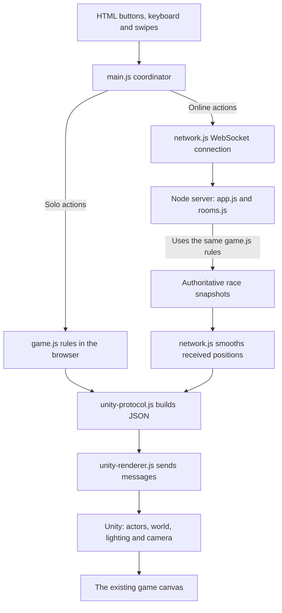

# How the Unity version connects to the game

Borrowed Time now has two cooperating parts: JavaScript runs the game and Unity draws it. The browser still owns the buttons, timer display, sound and room menu. In multiplayer, the Node server decides what actually happened. Unity receives those results and turns them into the runner, tunnel, hazards and camera view.

This keeps the existing four-player races and time purchases while giving us a separate place to improve art and animation.

**Where each decision belongs**

| Question | Code responsible |
| --- | --- |
| Does a boost cost time? Did a runner hit something? | `src/game.js` |
| Who owns this input? Who won the online race? | `src/server/app.js` and `src/server/rooms.js` |
| How do snapshots become smooth positions? | `src/network.js` |
| What should the buttons, timer and overlays show? | `src/main.js` and the HTML/CSS |
| What data does Unity receive? | `src/unity-protocol.js` |
| How is Unity loaded and called? | `src/unity-renderer.js` |
| How do the body, tunnel and camera look? | C# under `unity/Assets/Study/Runtime/` |

An *authoritative* system has the final say. Solo practice uses the browser's rules. Online play uses the server's rules. Unity never awards time, charges for an ability, creates a collision penalty or declares a winner.

**Follow one ability from button to picture**

1. The player clicks **Long jump**. `main.js` converts the click to the `longJump` action.
2. In solo play, `game.js` checks the purchase and updates the jump. Online, `network.js` sends that intention; the server checks it and returns the result in a snapshot.
3. The rules calculate the actual jump height. The bridge sends that height and the jump's progress to Unity.
4. Unity places the runner at that height and poses the legs, arms and torso around it. Landing compression adds body movement without changing whether the jump cleared an obstacle.

Running, lane switching and boosting follow the same route. Changing how a move looks should not change its price or the race result.

**The two messages crossing into Unity**

JSON is ordinary structured data represented as text. The browser sends it with Unity's `SendMessage` API to the GameObject named `BorrowedTimeRaceRenderer`.

| Message | Contents | When sent |
| --- | --- | --- |
| `LoadCourse` | Course length, obstacles, falling-debris schedule and checkpoints | When the course changes or presentation resets |
| `RenderFrame` | Current race time, local runner movement, visible opponents and presentation settings | Each browser drawing frame |
| `ResetPresentation` | No payload; clears previous presentation history | Restart, room change or rematch |

The course describes *where things are*. A frame describes *what is happening now*. Sending the course separately avoids repeating every obstacle in every frame.

Each payload has a protocol `version`. An `epoch` identifies a fresh presentation round; `sequence` orders frames within that round. The C# receiver rejects outdated rounds and duplicate or older frames, so a delayed message cannot restore the previous race after a rematch.

The shared `elapsed` clock controls debris. It continues for an online spectator after their own runner finishes. `dt` is a small time interval used for presentation; Unity does not add it to the race clock to invent game progress. A jump has a supplied height, duration and progress from 0 to 1; `jumpProgress = -1` means grounded.

Only the local runner carries private boost and hit effects. Opponents contain public movement and identity fields. Their speed is inferred from public positions; their time balances and ability flags are not sent. Finished/disconnected opponents disappear, and distance filtering keeps only racers within 18 game metres behind or 255 ahead.

**Inside the Unity project**

These files live under `unity/Assets/Study/`. *Runtime* code executes in the built game. *Editor* code assembles and exports the scene while developing it.

| File | Main job |
| --- | --- |
| `Runtime/RaceProtocol.cs` | C# data shapes matching the JSON, validation helpers and unit conversions |
| `Runtime/BorrowedTimeRaceRenderer.cs` | Receives messages, checks round/order, coordinates actors and world, and follows the runner with the camera |
| `Runtime/RaceActor.cs` | Places one runner, connects movement to the pose, applies an identity palette, and handles transparent opponents/local effects |
| `Runtime/GroundedRunnerPose.cs` | Authors the arm swing, stride, forward torso lean, jump poses and landing recovery; keeps the game runner level during lane changes |
| `Runtime/GroundedRigSetup.cs` | Prepares the neutral skeleton and its bone relationships |
| `Runtime/RunnerWardrobe.cs` | Builds the character's clothing shapes and materials around that skeleton |
| `Runtime/RaceWorld.cs` | Reuses nearby tunnel sections, places course hazards and advances visible debris from the supplied clock |
| `Runtime/RaceLighting.cs` | Repositions the tunnel's small light pool as the runner progresses |
| `Editor/RaceEnvironmentBaker.cs` | Builds reusable tunnel and hazard templates from the approved art |
| `Editor/RaceSceneBuilder.cs` | Assembles `Scenes/Race.unity` and exports the Unity Web build |

A *rig* is the skeleton used to move a model. *Inverse kinematics* positions a hand or foot and solves how its joints should bend. These tools give the character movement without importing the earlier Blender animation. They are visual tools; the game rules still supply the jump and forward progress.

The game's running performance uses a continuous animation phase. The arms and legs follow that phase through a lane change; the body keeps facing forward and does not bank sideways. A modest forward lean remains. `RaceActor` eases the animation cadence with speed and caps it at 2.6 full left/right cycles per second, so a boost can move the runner quickly without making the limbs cycle excessively fast. This is a stylized performance: the running foot loop is not a simulation of perfectly planted feet at every game speed. Jump height still comes directly from the rules. The separate study keeps its older contact-driven motion.

The camera retains the chosen landscape view: 7.4 Unity units behind, 2.2 above, with a 41-degree field of view. Portrait framing widens enough to include the outer lanes. Unity disables its global keyboard capture so the page can continue accepting names, room codes and gameplay controls.

Game metres and Unity scene units differ. Forward distance is multiplied by `0.21`, jump height by `0.43`, and adjacent lanes are `1.15` units apart. These conversions match the art to the existing rules; they do not speed up the race or change obstacle timing.

**What is preserved, and what is still limited**

The separate animation study and its preview remain available outside the game integration. Its automatic demonstration and looping track are not the live race controller. The original game source and Git history were backed up before this integration.

The Unity version currently uses **one Snow-based body and wardrobe with four automatic clothing palettes**. The four identities remain, but they do not yet have four distinct body designs. The older Three.js renderer retains its original separate character models. Keep the Snow base and surface-asset credits with the project.

For a comparison, append `?graphics=classic` to the game's URL, for example `http://localhost:4173/?graphics=classic`. This explicitly selects the preserved Three.js renderer. Remove the query parameter to use Unity. It is a review/fallback option, not an automatic renderer switch during a race.

**Rebuilding and running locally**

JavaScript and CSS edits can be checked by reloading the page. Changes to C# code, Unity materials or imported art require a new Unity Web export.

1. Open the repository's `unity/` project in Unity Hub, using the Editor version recorded in `unity/ProjectSettings/ProjectVersion.txt` and its Web build support.
2. After imports finish, choose **Borrowed Time → Game → Assemble Unity Race Scene**. This creates the game scene from the study assets.
3. Choose **Borrowed Time → Game → Export Unity Race for Web**. `RaceSceneBuilder.BuildWeb()` exports `unity/Builds/Race/` with gzip compression and browser decompression.
4. Copy these four files from its `Build/` directory into `assets/unity/v5/`: `Race.loader.js`, `Race.framework.js.gz`, `Race.data.gz`, `Race.wasm.gz`. The existing HTML page loads them; it does not use Unity's generated example page.
5. Run `npm install` if dependencies are missing, then `npm start`. Open the local URL printed in the terminal. Serve the page through Node rather than opening `index.html` directly.

The loader starts the Unity runtime; the framework contains JavaScript support; the data file carries built scene/assets; WebAssembly (`.wasm`) carries compiled code. The editable Unity project is separate from these exported browser files.

`src/server/app.js` allows only explicitly named public files. It streams large assets, marks gzip files with `Content-Encoding: gzip`, and supplies `application/wasm` for the code and `application/octet-stream` for data. The browser decompresses the bytes before Unity consumes them. `HEAD` requests return the same file headers without downloading the body. Responses currently use `Cache-Control: no-store` to avoid stale build files.

The server also accepts explicitly named uncompressed equivalents, but the current loader configuration requests gzip. Exporting with a different compression choice requires matching the loader URLs and serving configuration.

**Checking a change**

Run `npm run check`, `npm test` and `npm run test:network`. Protocol tests check jump values, privacy and reset data; asset tests check real HTTP headers and access restrictions using small fixtures. Those tests do not prove that a Unity build renders correctly.

Then inspect practice, hop/long jump/boost, actual obstacles, pause/restart, the four-player demo and rematch in the browser. Check room text fields and both portrait and landscape layouts. Public deployment and testing on a physical phone are separate verification steps; a desktop portrait viewport cannot establish phone performance.
