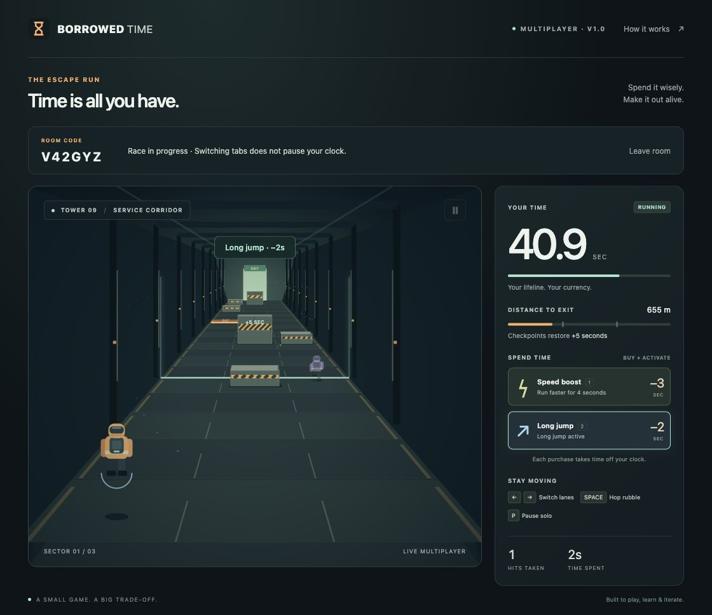

# Borrowed Time V1.0.0 — release record

**Status:** V1.0.0 implemented and verified locally on October 25, 2026.  
**Public deployment:** none. Local/LAN operation is the intended V1 delivery.  
**Runtime used for verification:** Node.js 24.21.0; package supports Node.js 22+. Graphics retain the original prototype style.

This version grows the 0.1 solo prototype into private multiplayer while preserving its three-lane mechanics and visual style. The [design record](V1_DESIGN.md) states the intended scope; this document records implementation and release evidence.

## V1 scope

- Solo practice plus private six-character room codes for 2–4 guests.
- Host-controlled start, a shared three-second countdown and course, individual runs, winner selection, and rematch after all runs end.
- Server-owned movement, collision penalties, purchases, cooldowns, clocks, and results.
- Real opponents drawn as transparent character models at relative positions. No player collisions, opponent statistics HUD, or opponent ability effects.
- Leaving, host transfer, explicit disconnect handling, and continued play for remaining racers.
- A Node HTTP/WebSocket backend, browser transport/interpolation, and shared JavaScript rules.

The server is one process with in-memory rooms. It uses Node.js 22+ and `ws`; the frontend remains HTML, CSS, JavaScript modules, and Canvas 2D. There is no build step.

## Run and verify

```sh
npm install
npm start
npm test
npm run test:network
npm run check
```

Run the server in one terminal and the checks in another. Ordinary `npm test` skips real-socket tests; the network script enables them with `RUN_NETWORK_TESTS=1`.

| Check | Recorded result |
| --- | --- |
| `npm test` | 35 passed, 4 socket tests intentionally skipped, 0 failures |
| `RUN_NETWORK_TESTS=1 node --test tests/server.test.js` (same command as `npm run test:network`) | 18 passed, including all 4 real-socket cases, 0 failures or skips |
| `npm run check` | All 7 JavaScript entry/modules passed syntax checks |
| Two browser clients, countdown, movement, purchases, visible ghosts | Passed: separate clients in one room, lane changes, boost and long jump, distinct spending, translucent rival visible |
| Results and rematch | Passed: both clients showed the same winner, own results, host-only rematch, fresh lobby and countdown |
| Disconnect/host transfer and remaining race continuation | Passed: host left during rematch countdown, guest became host and kept racing; server shutdown showed offline state and return-to-menu recovery |
| Solo regression and responsive controls | Passed: solo purchases/pause; 390×844 browser viewport, movement/Hop/long-jump buttons, room and disconnect layouts |
| Console | No warning/error entries during the normal two-client race |
| LAN across physical devices | Configuration documented; not tested on a second physical device |
| Container build | Dockerfile supplied; not executed because Docker is unavailable in the development environment |
| Public deployment | Not performed |

The two test commands cover **39 distinct tests** in total (the network command repeats the 14 room tests). This verifies behavior, not production capacity. An independent review identified frozen finished-player ghosts and permanent alerts for unavailable moves; both were fixed. Ghost removal has a regression test; action feedback was checked in the browser.



[Mobile viewport evidence](../images/v1-mobile.png). Viewport testing does not establish performance on physical phones.

Default address: `http://localhost:4173`. `HOST=0.0.0.0 npm start` permits LAN access; clients use the host computer's actual LAN address. `PORT` changes the port. Internet hosting must support persistent WebSocket connections, keep the Node service running, and provide HTTPS/WSS.

`GET /health` returns `ok` for a service health check. Default safeguards are 25 rooms, 128 connections, four players per room, 4 KiB WebSocket messages, 30 inputs per second, and 60 total messages per second per connection. Slow sockets and failed heartbeats are disconnected. Browser WebSocket origins must match the request host; this is not user authentication. These bounds are implementation settings, not load-test results.

## Known limitations

- No accounts or authentication, persistent leaderboard, matchmaking, chat, or reconnect/resume.
- Room codes are invitation conveniences, not authenticated access control.
- Rooms and results disappear on process restart. Empty rooms disappear immediately; idle lobbies and finished rooms expire after five minutes.
- A hidden multiplayer tab does not pause the race; disconnecting ends that player's run.
- Opponents expose only identity/connection/phase and motion fields needed for rendering. Their motion may reveal speed or jumping; V1 does not promise hidden movement.
- Gap resolution checks the front edge for an active long jump; continuous gap traversal and structural building physics are not simulated.
- Room/connection limits are safeguards, not benchmarked capacity. No production user count is available.
- No public submission URL, hosting account setup, or production uptime claim is included.

## Next version decisions

First complete a small real-device playtest and collect latency/control feedback. Then select hosting and verify a deployed two-client race. Add reconnects or saved results only with a clear lifecycle and data design. Use measured demand to decide when multiple processes or a database are needed.
