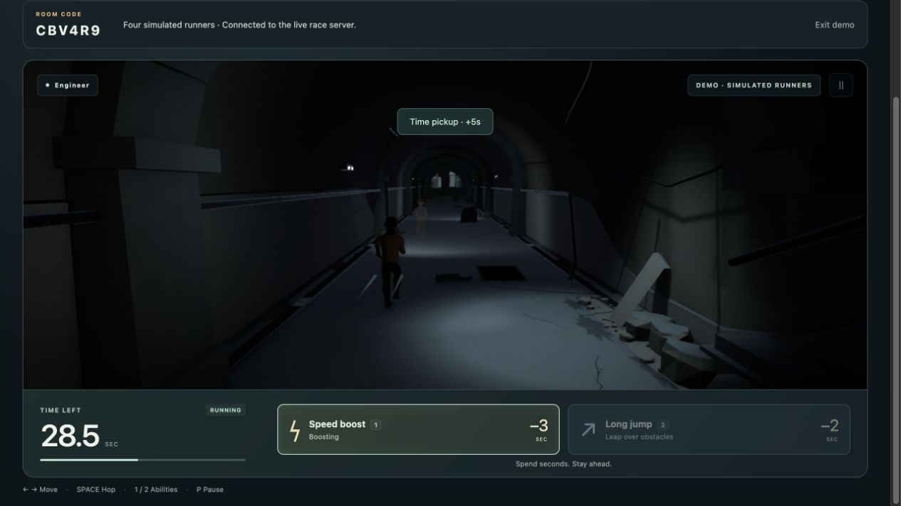

# V5 — Unity game integration

Version: **5.0.0-preview.1** · 2026-10-27 · **V5 complete — local checkpoint**.

Release tag: `v5.0.0-preview.1`. The approved visuals and final running style are active in the full local game: solo practice, private friend races and the four-player demo. The public Render deployment remains V4.

The approved Unity runner and tunnel now draw the actual solo and multiplayer race. The preferred pulled-back camera remains. JavaScript still handles rules, purchases, input, audio and networking; the Node server remains authoritative online.

The final [running-style update](V5_RUNNING_UPDATE.md) adds continuous arm swings and strides with a slight forward lean and no sideways lane-change lean. It is included in this V5 checkpoint. Its verification and backup are recorded separately; the integration measurements below describe the original V5 export.

## Included

- Refined silhouette, smooth continuous arm swings and strides, level lane movement, rules-owned jumping and landing recovery.
- One character body with four automatically assigned jacket palettes; transparent, distance-correct opponents without their private effects.
- Actual seeded rubble, barriers, gaps, shared-clock falling masonry and time pickups; tiled tunnel interiors ending at one final exit.
- Async Unity loading with progress, gzip Web build and streamed binary responses. Graphics failures stop local presentation and leave the online room.
- Editable Unity project in `unity/`, a [beginner walkthrough](../UNITY_GUIDE.md), and [asset attribution](../../assets/unity/CREDITS.md).
- Preserved classic Three.js renderer at `http://localhost:4173/?graphics=classic`.

Gameplay speed, difficulty, time costs, abilities and server protocol are unchanged. This visual integration does not add the discussed time shield or progression system.

## Verification

- `npm run check`: passed.
- `npm test`: 93 passed, 9 socket tests intentionally skipped by that command.
- `npm run test:network`: 27 passed, including real HTTP/WebSocket, gzip/binary MIME, HEAD bodies, strict asset access and four-player rematches. These require local socket permission; the initial sandbox-only attempt failed with `listen EPERM`, then the permitted run passed.
- Local `npm run check:deployment -- http://localhost:4173`: passed page/assets, Unity response headers, two clients, shared countdown, private boost/time spending, movement and disconnect cleanup.
- Unity 6000.6.7f1 compilation and compressed Web export succeeded. Final build hashes and byte counts are in `assets/unity/v5/build-manifest.json`.
- Editor replay of real JavaScript frames at 30/60/120 Hz: 241/481/961 frames, maximum position disagreement below 0.000002 Unity units and jump disagreement below 0.00000006. Gait endpoints agreed within 0.000001. Paused/stale frames, old sequence rejection, exact opponent lane and local-only boost effects passed. Contact error remained below 0.000005 units.
- Browser: paid jump, boost, lane movement, pause, four-player race completion/rematch, room-name typing, and a shared race between Unity and classic clients verified without console errors. Desktop portrait layout checked at 390×844; this is not physical-phone performance testing.

The browser reports an existing optional URP FSR upscaling shader warning. The build uses native render scale 1.0 and renders successfully; no browser runtime errors were observed. Broader browser/GPU coverage remains future work.

## Practical limits

The exported runtime is about **38.2 MiB compressed**. Removing unused game-only character texture references reduced it from about 52.6 MiB. Source originals remain available for editing. This is a larger download and memory commitment than the classic renderer; mobile load time, frame rate and thermal behavior need actual-device testing before promoting it to the public build.

This first integration shares one body/wardrobe across four palettes. It does not yet reproduce the four distinct body designs of the earlier renderer. Hazard art and tunnel repetition can receive further polish without changing the rules.

## Backup and rollback

The complete pre-integration source archive and Git history bundle were saved before editing:

`/Users/wes/.codex/visualizations/2026/10/26/01a175c3-b3a4-7953-92b0-d13d11ad4017/backups/pre-game-unity-integration-20261027-013919/`

The original branch is `codex/v4-public-playtest` at `6176c4a54cf4c05b338fdba66491f03ac0e0ec90`. Integration work is on `codex/v5-unity-integration`. The Git bundle passed `git bundle verify` and contains complete history.

For a non-destructive restore, extract `game-source.tar.gz` into a **new folder**, run `npm ci`, then `npm start` there. Stop the current local server first or choose another port. The archive includes `backup.json` with the source revision. Do not extract it over ongoing V5 edits.

The standalone Unity animation preview at port 9877 and its `VisualPass.unity` scene remain separate. The Render deployment was not changed by this work.

The final motion pass has its own verified pre-change source/build archive at `backups/pre-fluid-running-20261027-081417/` under the same task-artifact directory. Its `RESTORE.md` describes opening the prior version in a separate folder. The complete absolute backup location is also recorded in the [motion update](V5_RUNNING_UPDATE.md).
