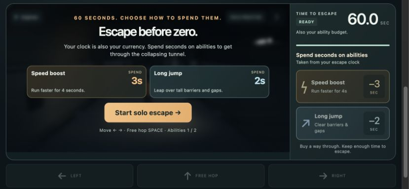
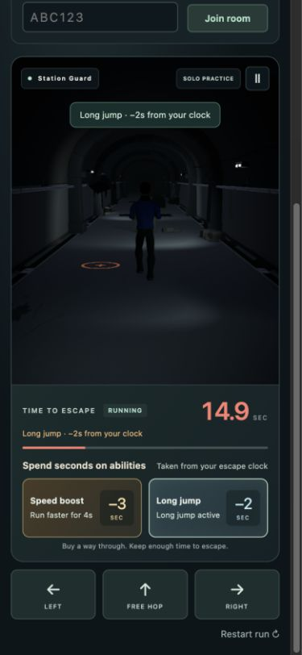

# V6 UI clarity update

This local UI pass responds to two playtest findings: players missed the abilities, and the game felt like an ordinary race without a clear time-spending mechanic.

## What players see

- The page introduces the survival race with “Your clock is your currency” and a short explanation of escaping the collapsing tunnel.
- The solo start screen, friend-race lobby and countdown introduce Speed boost (3 seconds) and Long jump (2 seconds), with their benefits. No extra tutorial screen or waiting period is added.
- The HUD labels the clock as both time to escape and the ability budget. A clear “Spend seconds on abilities” heading connects the buttons to that clock.
- Available abilities use stronger, distinct colors, larger price badges and explicit benefits. A brief two-cycle highlight draws attention at the start until a purchase is made. Reduced-motion preferences suppress the animation.
- A purchase displays “Speed boost · −3s from your clock” or “Long jump · −2s from your clock” both as a toast and beside the timer. The timer highlights briefly, with low-time red taking priority.
- Buttons explain active effects, recharge time and insufficient time. Ordinary hopping is explicitly labeled free.
- Reset clears prior round notifications and purchase feedback.

These changes are in `index.html`, `styles.css` and `src/main.js`. Game rules, prices, course difficulty, graphics and server behavior remain the approved V6 gameplay. The UI consumes the local player's existing authoritative events online.

## Verification

- JavaScript syntax check and 97 standard tests passed; nine socket tests are intentionally separate.
- All 27 real HTTP/WebSocket checks and the local deployment smoke check passed.
- Browser review covered the ready screen, solo start, boost and long-jump purchases, active/recharge states, low-time display and insufficient-time state.
- Narrow portrait review at 390×844 found no horizontal page overflow; ability and movement buttons fit the play viewport after the course scrolls into view. Short landscape review at 844×390 found the briefing fit its overlay without internal overflow. These are desktop viewport checks, not physical-phone testing.
- Two real clients saw the lobby briefing and shared countdown, then entered the race. A host purchase displayed its clock-debit feedback; the guest retained its own ability state and budget presentation. No browser runtime errors were observed.

## Preservation

Before this UI pass, V6's harder gameplay was saved at commit `073bc5bc16060b1abef84b190b7ab795a142c33a` on `codex/v6-difficulty-playtest`. A verified complete Git bundle, including Unity source, the playable graphics build and previous versions, is at:

`/Users/wes/.codex/visualizations/2026/10/26/01a175c3-b3a4-7953-92b0-d13d11ad4017/backups/pre-ui-v6-20261027/borrowed-time-v6.bundle`

The original project folder and conversation are retained. The public deployment remains V4; this UI is in the local game.
