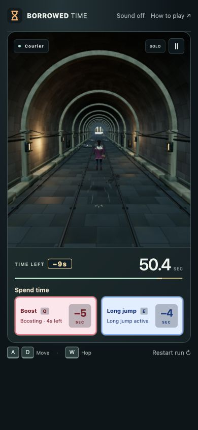
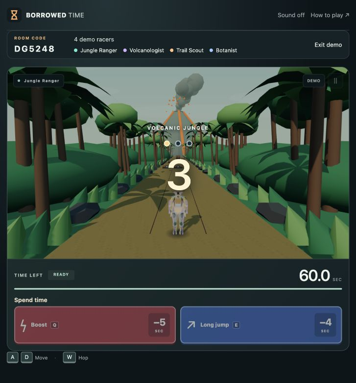
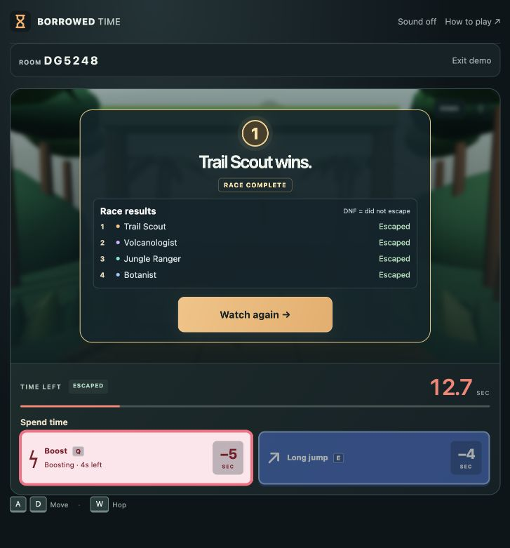
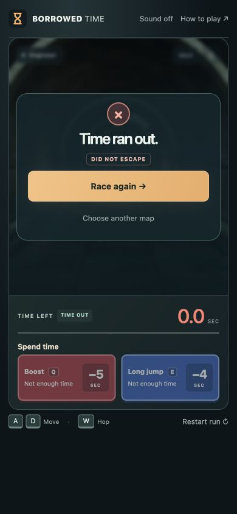

# V8.2 · Clock, countdown and finish feedback

Local playtest, October 27, 2026. **Not pushed or deployed.** Public V8 remains runtime `8f9552f43f276c75e2d55c6c155ca500e4b6f2c8`.

## Try it

Open http://localhost:4173/ and refresh an older tab. Play solo to try Q/Boost and E/Long jump, or Watch demo to see the shared countdown and four-player result. Boost still costs **5 seconds**, Long jump **4 seconds**.

Look for the brief debit next to the clock, the ability button confirming a purchase, the countdown/start transition, and whether the final result and next action read clearly. There are no extra gameplay steps or added solo start delay.

## Spending feedback

Only a confirmed increase in `timeSpent` triggers purchase feedback. Ordinary clock drain, collision penalties, pickups and rejected inputs cannot generate a purchase debit. Purchases within 650 ms combine, so Boost plus Long jump shows **−9s**. The actual remaining-time display updates immediately from game state; it never counts through an invented balance.

A brief debit replaces the existing clock status badge without adding a line or moving the controls. A segment on the clock bar shows the purchased amount, and only the purchased ability buttons receive confirmation. An accessible live announcement names the abilities and cost. Effects are bounded, cancelled on reset, and optional animation is disabled with reduced motion.

## Start and finish

Multiplayer retains its authoritative three-second countdown, now with three lights and a clearer number. A pointer-transparent GO appears only when the race actually starts. Solo starts immediately with GO; controls and simulation never wait for it. Pause, replay and new rounds clear old transient effects.

Sound stays muted by default. Players who opt in hear short countdown and GO tones; hidden tabs remain silent. Escape uses the existing chime and time-out gains a restrained ending tone.

Results distinguish a confirmed winner, an escaped racer and a racer who did not escape. Winning is announced only after the room confirms the final winner. Live unfinished races show that other racers are still finishing. Replay and return-to-voting actions follow existing room rules. Solo results keep setup menus hidden so the finish panel remains in view, with Race again and Choose another map actions. No distance, spending totals or extra stats were added.

The clearer start view also exposed a floor cutoff behind outdoor starting lines. Static matching ground now extends behind the start; playable terrain and collisions are unchanged.

## Code and preservation

- `src/race-presentation.js` observes confirmed game/room state and derives feedback without mutating rules.
- `src/race-ui.js` presents bounded DOM animations and accessible announcements.
- `src/main.js` coordinates existing state, countdown overlays and results.
- `src/audio.js` adds optional cues without starting audio automatically.
- Static asset serving explicitly allows the two new modules.

Compared with V8.1 commit `199ec63`, `src/game.js`, `src/hazards.js`, `src/server/rooms.js`, `src/network.js`, `src/demo.js` and `src/maps.js` are unchanged. Physics, speed, collisions, jump timing, course generation, controls, private purchases and standings authority are retained.

Before edits, a complete-history backup was created and verified at `backups/pre-v8.2-race-feedback-20261027.bundle`. Work is on local branch `codex/v8.2-local-race-feedback`; earlier versions remain preserved.

## Verification

- Syntax and whitespace checks passed.
- Unit suite: **138 passed**, 11 real-network tests skipped by the default command.
- Real HTTP/WebSocket suite: **37 passed**, including all six maps.
- Local release checker: **62 assets**, countdown, movement, private purchases, shared hazards, standings and cleanup passed.
- New tests cover confirmed spending, combined costs, late joins, countdown/GO, pause/reset, final authority, reduced motion, animation cancellation and opted-in audio.
- Independent review found ready-state updates cutting countdown tones short. A regression test reproduced the issue before the fix and passes after it.
- Browser checks confirmed Q/E deductions, combined −9s, no purchase-induced HUD height shift at 390×844, natural four-player winner, natural solo time-out, rematch reset and return to map selection. Result actions fit inside the arena at 390×844 and 844×390. No browser console errors were observed.

Responsive browser checks are not a physical-phone performance or audio-quality assessment. User local playtesting comes before any deployment.

