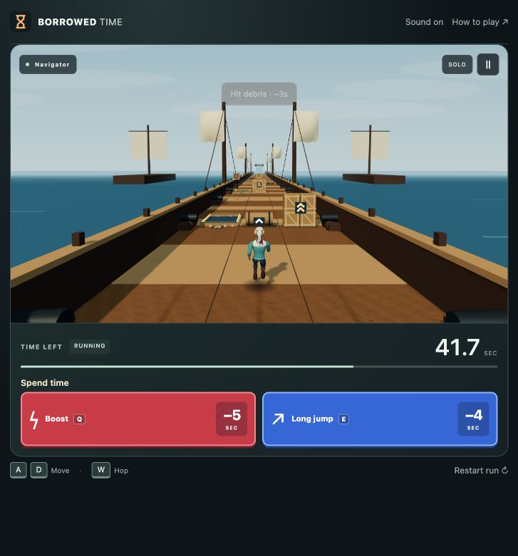
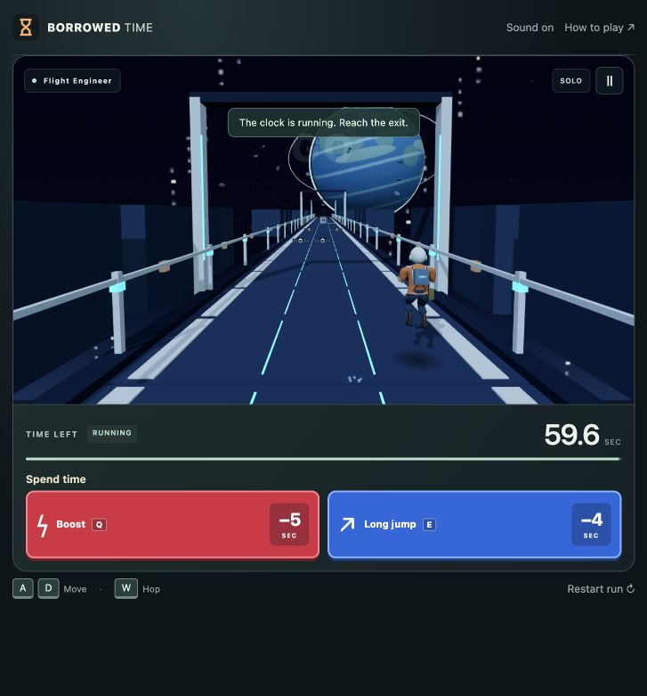
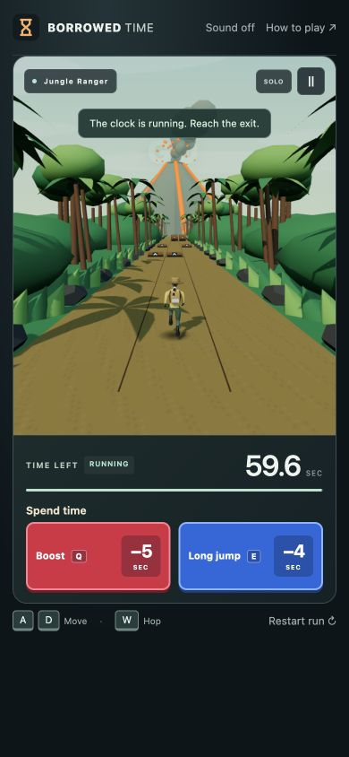

# V8.3 · Audio and map atmosphere

Historical local-playtest record. These changes were subsequently published in the [V8.4 public release](V8_4_PUBLIC_PLAYTEST.md) on October 28, 2026.

Local preview, October 27, 2026. **Not pushed or deployed.** Public V8 is unchanged.

## Try it

Refresh http://localhost:4173/. Click **Sound off** in the header to enable the new sound, choose a map, and Play solo or Watch demo. Sound starts muted and requires that click; no audio downloads, microphone permission or account are involved.

Listen for surface differences, nearby danger, and whether the musical pattern stays comfortably behind the game. Watch the sails, foliage and weather while checking that hazards remain easy to read. The new music is a restrained original synthesized pattern, not a recorded soundtrack; balance and sound character are intended for local playtesting.

## Audio

Each map has its own footsteps and landing profile: stone contact, wooden body, soft jungle soil, bright snow crunch, metallic station contact or sandy scuff. Existing jump, paid long-jump, boost, collision, countdown/GO and finish cues remain.

Nearby roof/rock/cannon/fragment events now sound at their authoritative warning and impact times. Their lane controls stereo direction; mono playback still receives the cue. A quiet filtered ambient bed varies by map. A sparse original eight-note sequence has map-specific register, shorter intervals and a low pulse as remaining budget drops. The budget changes the music only; shared debris timing always uses race time. Musical notes are quieter around danger cues. Visual hazard markers remain available while muted.

All voices are short, scheduled and disconnected after completion, with a hard limit of 24. Audio is silent before opt-in, while paused or hidden, and after mute/disposal. Resume and new sessions do not catch up old sounds. The only new memory buffer is two seconds of locally generated mono noise; no permanent music loop or external service is used.

## Atmosphere

- **Tunnel:** sparse suspended dust at the edges, retaining the bright escape progression.
- **Ship:** gently billowing authored sails and sparse sea spray beyond the deck lanes; existing ocean motion retained.
- **Jungle:** slight crown movement and drifting ash at the margins; the existing erupting volcano remains ahead.
- **Frozen:** drifting edge snow alongside existing distant avalanche clouds.
- **Orbital:** slow amber warning lights aligned to the existing edge supports and sparse floating particles; no rapid flashing.
- **Desert:** windblown edge dust alongside the existing distant sandstorm.

Each map uses a fixed 72-point cloud; the old expansion particle cloud was replaced. Station beacons use one instanced mesh. Existing static geometry remains batched except for the specific animated sails and crowns. Effects do not create collision objects, cover running lanes, move the camera or change warnings. Reduced motion hides optional particles, freezes foliage/cloth movement and holds warning lights steady. Existing map-specific background behavior retains its reduced-motion handling.

## Code and backup

`src/audio-scene.js` is a read-only sound director that observes local scalar state and shared hazard schedules. `src/audio.js` synthesizes bounded voices after opt-in. `src/graphics/atmosphere.js` owns the fixed-size edge layer; `src/renderer.js` creates/releases it on map changes and disposal. `src/graphics/worlds.js` separates the moving sail/crown meshes before static batching. `src/graphics/expansion-worlds.js` retains the established landmarks and removes the superseded particle layer.

Backup: `backups/pre-v8.3-audio-atmosphere-20261027.bundle`, verified complete history before edits at V8.2 commit `ff0bb29`. Local branch: `codex/v8.3-local-audio-atmosphere`.

The rule files `src/game.js`, `src/hazards.js`, `src/server/rooms.js`, `src/network.js`, `src/demo.js` and `src/maps.js` are unchanged. Boost is still **5 seconds**, Long jump **4 seconds**. Course placement, physics, collisions, controls, race authority and the behind-runner camera are unchanged. No new dependencies or downloaded assets.

## Verification

- Syntax and whitespace checks passed.
- Unit suite: **143 passed**, 11 real-network tests skipped in the default command.
- Real HTTP/WebSocket suite: **37 passed**, including all six maps.
- Local release checker: **64 assets** plus countdown, shared course, movement, private purchases, standings and cleanup passed.
- Tests cover surface profiles, nearby authoritative warning/impact deduplication, urgency without state mutation, bounded audio graph resources, pause/hidden/mute/disposal, edge exclusion, reduced motion, fixed geometry and cleanup.
- Independent review caught reverse-scrolling particles/beacons; the optical-flow regression failed before the fix and passes after it.
- Browser: all six maps start with Sound on and movement input; pause and mute checked; no console errors observed. 390×844 viewport has no horizontal overflow and ability buttons remain inside the viewport.

Automated graph checks and browser state do not establish sound quality or physical-phone performance. Those remain local listening/playtesting tasks before deployment.

