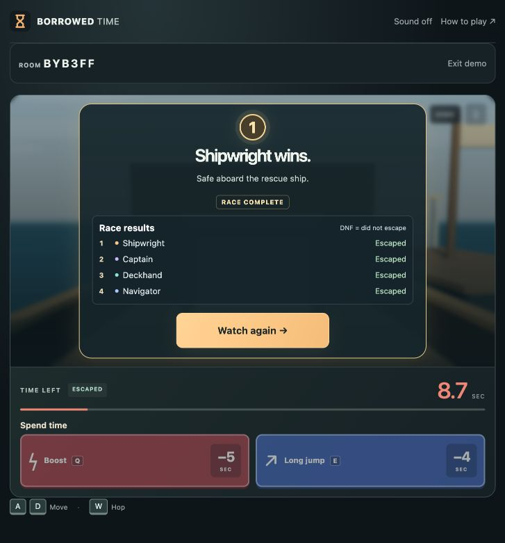
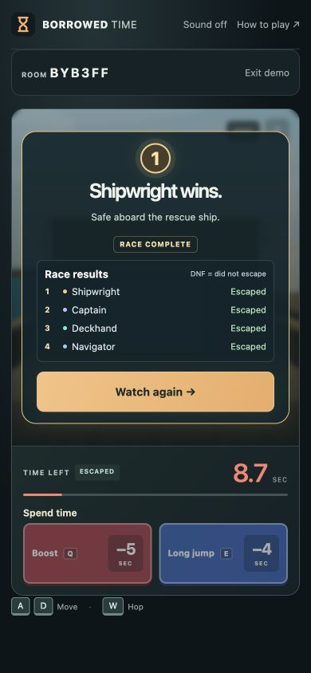

# V8.4 · Finish, transitions and reliability

Historical local-playtest record. These changes were subsequently published in the [V8.4 public release](V8_4_PUBLIC_PLAYTEST.md) on October 28, 2026.

Local preview, October 28, 2026. **Not pushed or deployed.** Public V8 remains unchanged.

## Try it

Refresh http://localhost:4173/. Try an unavailable six-character room code, then choose a map and Play solo or Watch demo. Check map/card transitions, the destination ahead, and the finish panel. Watch again returns to the normal shared countdown. Sound remains off by default.

## What changed

Screen cards enter with a brief 180 ms fade/translation; inputs and the simulation do not wait. Countdown numbers keep their existing animation rather than replaying an entire card entrance. Winner results gain a restrained gold border, halo and short spark. Escaped and DNF outcomes remain distinct, and only an authoritative winner gets the winning presentation. No extra stats or result menus were added.

Six cosmetic destinations sit beyond the existing finish line: daylight plaza framing, a rescue vessel alongside the ship, jungle evacuation tent, mountain shelter, escape shuttle and sandstone refuge. Small ground extensions lead the eye onward. A local ground halo expands once when the actual runner escapes, then ends; no DNF burst, opponent-triggered burst or looping celebration. Reduced motion disables it. Existing playable scenery, warnings, obstacles and camera remain.

Escaped players get a short map-specific arrival message. Waiting for racers retains priority. Results stop showing leftover active-ability glow/recharge status after the simulation ends. Buttons use consistent 44px minimum action targets, pressed feedback and visible keyboard focus without changing the compact leaderboard.

Loading now reports completed, validated character assets out of the 24-character cast, rather than staying at zero. A progress bar has an accessible loading label. One 45-second deadline covers both classic renderer/module imports and character preload. A stalled/failed load produces Reload; late work cannot instantiate the renderer or update the progress UI after timeout. This is completion count, not a byte-download percentage.

Failed initial joins (including missing/full/started rooms) return to the code field with the server's error visible. Existing disconnected-race recovery still returns to the menu, without inventing reconnection or resuming an abandoned race. Server authority, host transfer, disconnect rules, voting and rematches remain unchanged.

## Code and backup

- `src/graphics/finish.js`: small batched destination landmarks and a reusable local escape ring, released on map change/disposal and reset between runs.
- `src/finish-destinations.js`: presentation-only arrival copy/colors.
- `src/loading.js`: deadline and complete classic-loading orchestration, returning a renderer factory only after successful loading.
- `src/graphics/avatars.js`: actual validated completion progress, preserving shared in-flight loading and retry behavior.
- `src/race-ui.js`: bounded, cancellable card entrances with reduced-motion handling.
- `src/main.js`: error recovery and coordination; purchase/race rules unchanged.

Before edits, `backups/pre-v8.4-finish-polish-20261027.bundle` was verified as a complete-history backup of `6775c67` (V8.3 plus self-label fix). Local branch: `codex/v8.4-local-finish-polish`.

`src/game.js`, `src/hazards.js`, `src/server/rooms.js`, `src/network.js`, `src/demo.js` and `src/maps.js` are unchanged. Boost is still **5 seconds**, Long jump **4 seconds**. No new dependency, external asset, postprocessing pass, dynamic light or camera movement. Landmarks are batched; the escape effect reuses one mesh.

## Verification

- Syntax and whitespace checks passed.
- Unit suite: **147 passed**, 11 real-network tests skipped in the default command.
- Real HTTP/WebSocket suite: **37 passed**, including six-map races, room errors, disconnect/host behavior and rematch rules.
- Local release checker: **67 assets**, private purchases, countdown, shared hazards, standings and connection cleanup passed.
- New tests cover map destination identity, escape/reset/reduced-motion/DNF behavior, disposal, actual asset progress and loading deadlines. A stalled-module regression failed before the loading orchestration fix and passed afterward, including late completion safety.
- Independent review found the original deadline excluded module imports; the complete classic loading operation is now covered.
- Browser checks: unavailable-room error returns to the focused code field; all six maps start without console errors; natural four-player ship race and rematch; phone result controls fit inside the arena at 390×844 and 844×390.

Browser viewport checks are not physical-phone performance measurements. Audio quality, pacing of transitions and finish payoff remain local playtest judgments before deployment.

