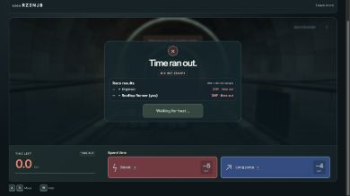

# V8.4 · Public phone playtest

October 28, 2026. User authorized deployment to the existing Render service and public URL: https://borrowed-time.onrender.com/.

Publishes the approved local V8.1–V8.4 polish: obstacle readability and movement feedback, confirmed spending feedback, countdown/results, audio/atmosphere, persistent self labels, themed escape destinations, transitions, loading progress/deadline and room-join recovery. Six maps and every gameplay rule/price remain unchanged from V8 (Boost 5s, Long jump 4s).

Previous public runtime `8f9552f43f276c75e2d55c6c155ca500e4b6f2c8` remains preserved in Git and the local complete-history backup bundles. Latest pre-polish backup: `backups/pre-v8.4-finish-polish-20261027.bundle`. Earlier V8.1–V8.3 bundles also remain.

Deployment targets the existing single Render Docker instance `srv-dbfpmdss728c73cgrqu0`, auto-deployed from private GitHub main. Existing room state is in memory; restarting the service ends active rooms.

## Deployment verification

- Render deployment `dep-dbgncccs728c7391pj3g` is Live; the service reported live October 28, 2026 at 12:13 AM Eastern.
- Runtime revision: `36d682d2610a6f9906fbf5401b59c15efc0ea690`.
- Pre-deployment syntax and whitespace checks passed; 147 unit checks and 37 real-network integration checks passed (11 socket tests skipped only in the ordinary suite).
- Public release checker passed all 67 assets, health, real two-player WSS create/join/countdown, purchaser-only Boost and Long jump, shared hazard schedules, standings and connection cleanup.
- Public index, main.js, styles.css, finish.js, loading.js, race-ui.js and atmosphere.js match the approved local files byte-for-byte.

Refresh an older browser page before racing. Physical-phone testing remains the user's next step; browser viewport checks do not establish actual phone performance.

- Two real public browser clients created/joined a room and ran a natural race. The deployed final results include `Rooftop Runner (you)` and the escaped/DNF status; browser console had no errors. Verified the results at a 390×844 browser viewport.

