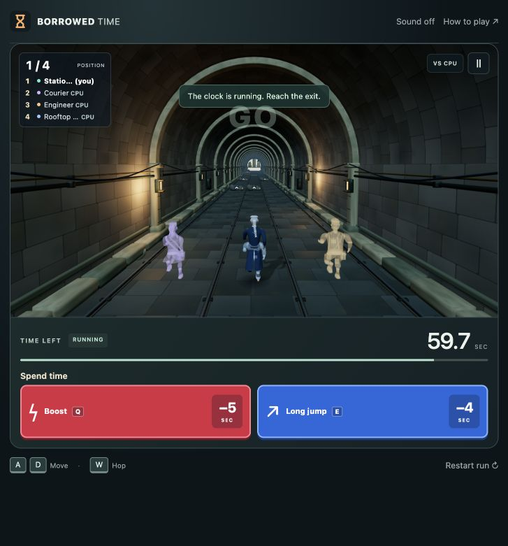
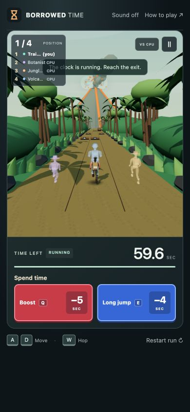
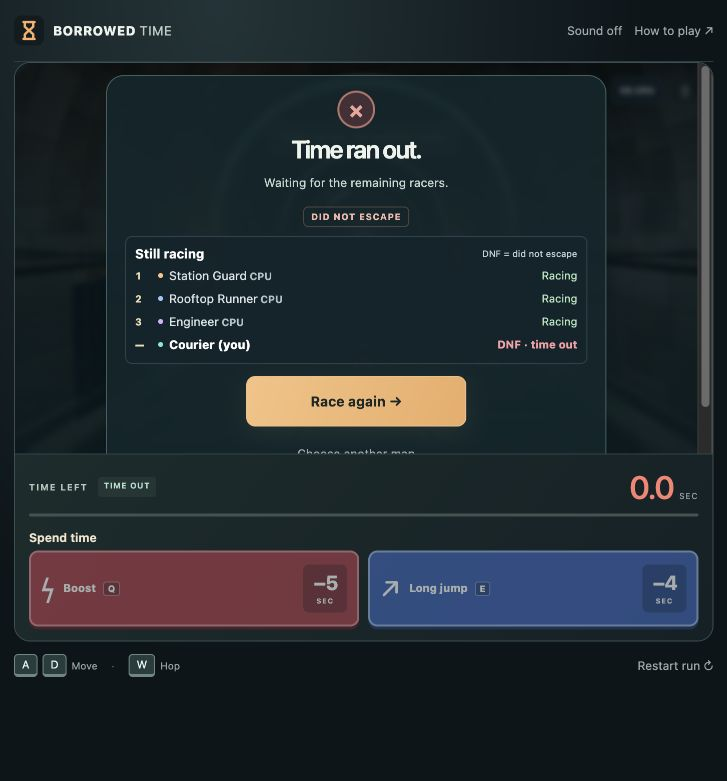

# V8.6 · Solo computer racers

Local preview, October 28, 2026. **Not pushed, deployed or submitted.** Public V8.4 is unchanged.

## Try it

Refresh http://localhost:4173/, choose any map, then **Race computers**. You control your runner; the other three are marked **CPU**. Your live and final row retains **(you)**. CPUs use the map's remaining three characters and role names.

The run starts immediately, with the existing GO cue and starting grid. Q/Boost still costs 5 seconds, E/Long jump 4; all movement, collision, checkpoint and time rules are retained. Sound remains opt-in. No name, character or difficulty menu was added.

Pause or open the guide during your run to freeze the whole race. Switching away pauses the human's active run and freezes CPUs; use Resume on return. After your run ends, remaining CPUs can finish naturally so the final standings settle. Hidden tabs do not advance that spectator simulation. Race again remains available immediately, and Choose another map still returns to the picker.

## How it works

`src/solo-race.js` owns a local race with four separate game states and a common fixed-step clock. It creates a fresh seeded course, assigns four distinct map characters, and uses the same stable start grid as multiplayer (center, left, right, center; four racers share three lanes).

The CPUs reuse `chooseDemoAction` at 150 ms decision intervals. Each applies normal lane, hop and purchase actions to its own game state. They have different spending schedules, so they can gain and lose position naturally. They pay their own time, collide and finish under the normal rules. No rubber-banding or extra speed multiplier is used.

A single debris schedule advances against all active racers before a physics step, matching the shared-hazard approach used by online rooms. Individual collision resolution and budgets remain separate. Standings sort escaped racers by actual finish time, then active runners by progress; DNF gets no finishing place. Winner presentation waits for the completed local race. CPU finishes do not invent a result for the human.

`src/main.js` routes solo fixed steps and read-only opponent views through this controller. The existing renderer draws the opponents at relative positions, including the usual behind/ahead visibility limits. Opponent views omit private ability budgets/state. The existing leaderboard/results UI now accepts either a local race snapshot or the usual server snapshot; CPU tags remain visible beside shortened names.

Local solo uses no WebSocket connections. Friend rooms and Watch demo keep their existing networking paths. Leaving, restarting or selecting a new map discards the old solo race and resets visual/audio feedback.

## Backup and checks

Before edits, complete Git history at `73141d0` was saved and verified in `backups/pre-v8.6-solo-rivals-20261028.bundle`. Work is local on `codex/v8.6-solo-rivals`.

- Syntax and whitespace checks passed.
- **153 unit checks passed**, with 11 network checks skipped only by the default command.
- **38 real-network integration checks passed**, preserving online races, purchases, voting and rematches.
- Local release checker passed **68 asset routes**, countdown, shared course, private purchases, movement, standings and connection cleanup.
- New tests cover distinct casts/grid/shared courses on all maps, pause, separate budgets, fresh races, normal CPU finishes, standings and continued racing after human DNF. Seed 42 diagnostic races completed with all three CPUs escaped on every map.
- Independent review found no actionable issues in shared timing, pause/tab-hide, cleanup or final-result handling.
- Browser checks: real Q/E purchases, four live rows, visible CPU/(you) labels, paused clock stable, natural human DNF, replay immediately available and fresh clock/roster. Jungle at 390×844 fits without horizontal overflow, with ability controls inside the viewport. No console errors observed.

Viewport checks are not physical-phone benchmarks. CPU difficulty and strategy feel remain playtest questions; this pass adds competition to solo without changing base speed, prices or obstacles.

