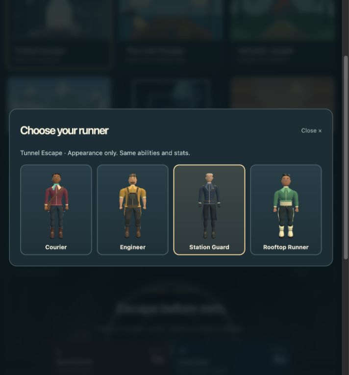
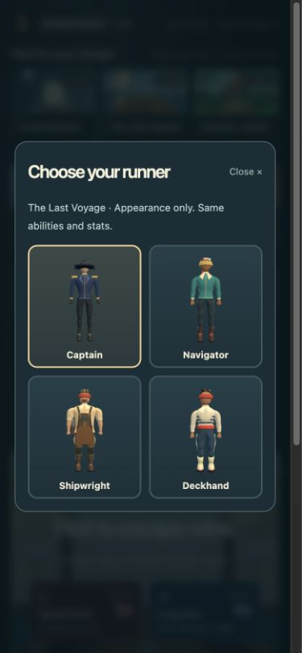
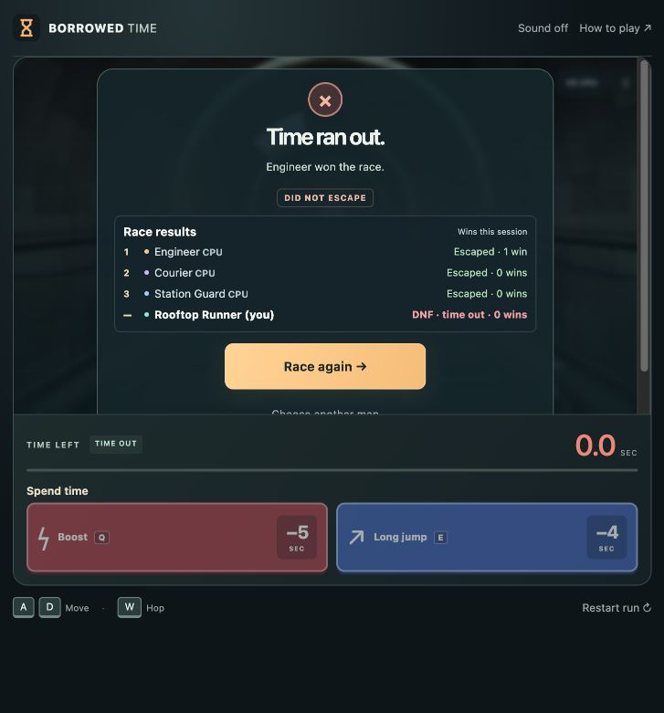
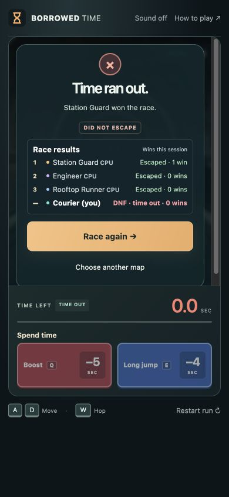

# V8.7 · Character choice and session wins

Local preview, October 28, 2026. **Not pushed, deployed or submitted.** Public V8.4 remains unchanged.

## Try it

Refresh http://localhost:4173/. Pick a map, then optionally choose **Change character**. The four portraits are the actual map's game models. Choosing is cosmetic: speed, hitboxes, jumps, time, ability prices and movement rules are identical. Skipping the picker retains an automatic choice and starts immediately.

Solo uses the other three roles as CPUs. Multiplayer lets players choose the same character with distinct existing player colors. The picker follows your voted map; if another map wins, your remembered choice for that map is used, or an automatic default. Choices lock when countdown starts. Changing a costume never changes accumulated wins.

## Session totals

A **win means first place**, not simply reaching the exit. One point is awarded to the earliest actual finisher after a complete physics step, once per round. If nobody escapes, no point is awarded. Escaping second or later still shows Escaped but adds no win.

Totals appear beside players in the multiplayer lobby and beside escape/DNF status in results. Live positions retain the compact HUD. The final self label remains (you); CPUs remain explicitly marked CPU. Points can be recorded before every other racer ends, because the first finisher is already decided; this also preserves a win when solo Replay is clicked immediately.

- **Multiplayer session:** same room membership through rematches and map changes. Leaving/disconnecting ends that player's identity; a new connection starts fresh. Room totals are in memory and restart with the server.
- **Solo session:** current page/tab across replays and map changes. Human identity is stable; each CPU strategy seat retains its own total even when the map/costumes change. Reloading starts a new session.

There are no accounts, saved career records or global leaderboard. The unit of persistence is the current play session.

## Cover and description

The current cover now reads **SOLO + MULTIPLAYER ESCAPE RACING** and **1–4 PLAYERS / 6 MAPS**. It uses actual pirate-ship gameplay. The preceding image remains as `artifacts/submission/cover-v1.png`; the current image is `cover.png`. The local review page and description draft explicitly mention solo with computer racers. The existing silent video is unchanged.

## Implementation

- `src/session-scores.js`: session ledger, winner/round deduplication and player-ID totals.
- `src/server/rooms.js`: lobby-only map validation, per-map preferences, winning-map assignment and server-owned score awards. Public snapshots expose wins; private budgets/abilities remain private.
- `src/solo-race.js`: shared ledger passed across fresh local races; awards after normal simulation steps and exposes read-only win totals in its UI snapshot.
- `src/graphics/portraits.js`: on-demand still portraits from preloaded assets using one temporary WebGL context, released after the four images are cached. No new art downloads or continuous preview renderers.
- `src/main.js`: optional picker, character preference coordination, lobby/result totals; live gameplay layout stays compact.

## Backup and verification

Complete history at `4532694` was preserved and verified in `backups/pre-v8.7-characters-session-20261028.bundle` before edits. Branch: `codex/v8.7-characters-session`.

- Syntax and whitespace checks passed. Core game.js, hazards.js and maps.js are unchanged.
- **157 unit checks passed**, 11 socket checks skipped only in the default command.
- **40 real-network suite checks passed**, including new behavior and updated explicit public win fields.
- Local release checker passed **70 asset routes**, countdown, movement, private purchases, shared hazards and cleanup.
- New tests cover map-only validation, countdown locks, duplicate choices, winning-map preferences, costume changes/rematches, once-only first-place awards, no award for all-DNF, and solo carry-over across maps.
- Independent review found no actionable issues in identity, scoring, preferences or portrait cleanup.
- Browser: selected Rooftop Runner carried into solo; two real clients selected Captain in the same room with distinct color dots and correct role labels. A natural solo result displayed one CPU win and other racers' zero totals. The 390×844 portrait picker shows only the map's four roles in a 2×2 grid and fits inside the viewport. Phone results also fit at 390×844 with one CPU win, readable (you)/CPU labels and replay inside the arena. No browser errors observed.

Browser-size tests do not measure physical-phone performance. Current session totals intentionally reset on reload/leave rather than restoring identities.

