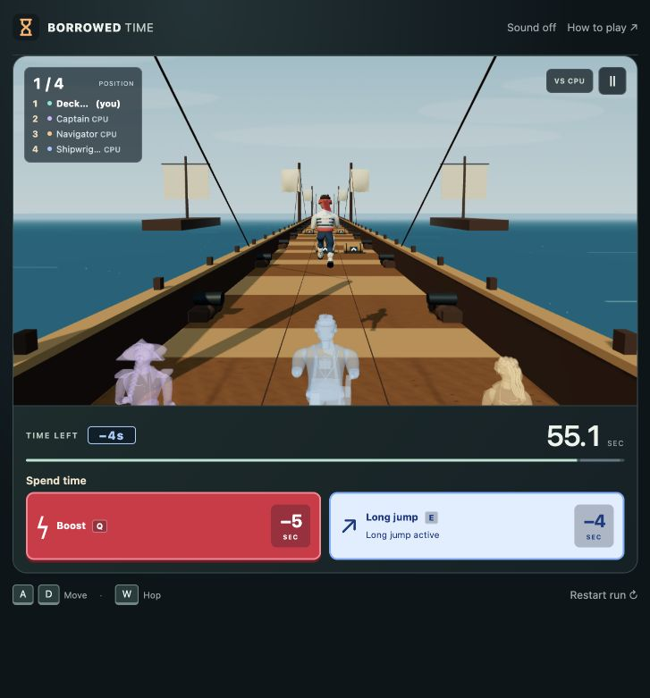

# V8.8 · Forward-leap playtest

Local playtest, October 28, 2026. **Not pushed, deployed or submitted.** Public V8.4 is unchanged.

## Try it

Refresh http://localhost:4173/, select a map and Race computers. Press **E** or tap **Long jump**. Compare it with **Q / Boost**, including a leap toward a barrier, a gap, and clear ground. All characters share the same updated rules.

## Tuning

| Property | Previous paid jump | Local forward leap |
| --- | --- | --- |
| Cost | 4 seconds | 4 seconds |
| Airtime | 1.4 seconds | 1.2 seconds |
| Apex | 3 | 2.6 |
| Airborne forward speed | Normal running speed | 1.9× base running speed |
| Approximate starting-speed range | 34m | 55m |
| Barrier clearance threshold | 2.2 | 2.2 |

Distances are internal tuning measurements, not extra player HUD stats. The new arc is about 13% lower, 14% shorter and travels about 63% farther at starting speed. Those are mechanical comparisons, not a guarantee of better subjective balance.

Boost retains cost5s, duration4s, multiplier1.85 and cooldown7s. It remains the sustained sprint; the paid leap adds a shorter burst while clearing correctly timed ground obstacles. Movement bonuses use their maximum, rather than multiplying together. A simultaneous Boost continues for its remaining duration after landing. Normal hit penalties/stun still apply, and an overhead impact can still strike an airborne runner. No invulnerability was added. The free hop is unchanged.

The visible paid pose now leans forward with a leading lower leg reaching out and a trailing leg extending back. No sideways banking or fake root-position advance was added. The actual race distance earns the lead, so opponents can fall behind naturally. Public jump timing gives rivals the same readable silhouette; private boost/hit state remains excluded. Landing recovers into the existing running animation. A short optional launch whoosh is stronger for the paid leap.

## Shared implementation

- `src/game.js`: rules-owned airtime, height, airborne movement factor and exported analytic `projectTravel`. Collision and rendering still use the same `getJumpHeight` function.
- `src/hazards.js`: leap duration boundaries and speed enter earliest-arrival prediction, preventing a forward burst from outrunning a collapse schedule.
- `src/demo.js`: CPU timing uses the shared projection, including prospective leap movement. Solo CPUs reuse this driver.
- `src/ability-coach.js`: hints project the faster proposed leap and use the shared arc, including gap far-edge and reaction-time checks. Roof warnings remain a reason to dodge.
- `src/graphics/avatars.js`: procedural paid-leap posture is applied after sampling, without accumulating into cached animation tracks.
- Existing server room stepping, private budgets, session totals, character choices and course layout remain.

## Backup and checks

Complete history at `621b6d3` was preserved and verified in `backups/pre-v8.8-forward-leap-20261028.bundle` before edits. Branch: `codex/v8.8-forward-leap`.

- Syntax and whitespace checks passed.
- **163 unit checks passed**, with 11 socket checks skipped only in the default command.
- **40 real-network checks passed** and the local **70-asset** release checker passed, including real private purchases/movement/shared hazards.
- Independent analytic tests check forward distance, exact burst expiry, Boost/stun interaction, pause, future-travel projection and genuine barrier/gap clearance. Early/late barrier collisions and overhead hits remain covered.
- Existing timing fixtures were moved to their equivalent positions under the new forward speed; the expired-gap fixture remains beyond the new leap range. Legacy Unity serialization still carries the actual shared arc.
- A regression checks forward torso/lead-leg/trailing-leg pose and absence of accumulated offsets.
- Seed42 local CPU diagnostics: all three CPUs escaped with zero hits on every map. Full demo/solo tests pass.
- Independent review found no actionable issues in endpoints, collisions, projections, hazards or public pose privacy.
- Browser: E and on-screen Long jump charge 4s, move the human ahead of CPUs and render the paid pose; restart resets normally, with no console errors. This is a local feel/balance experiment; physical-phone assessment is still needed.

